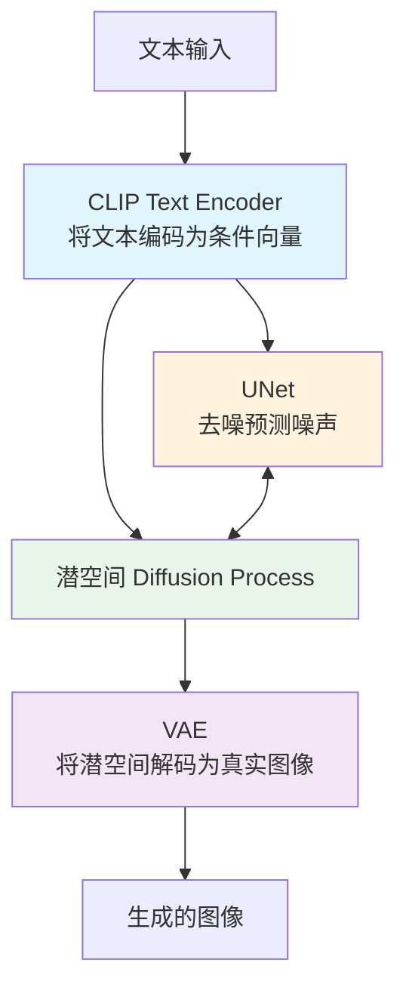
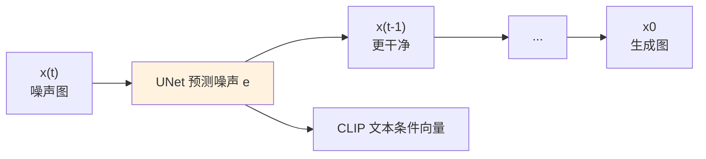
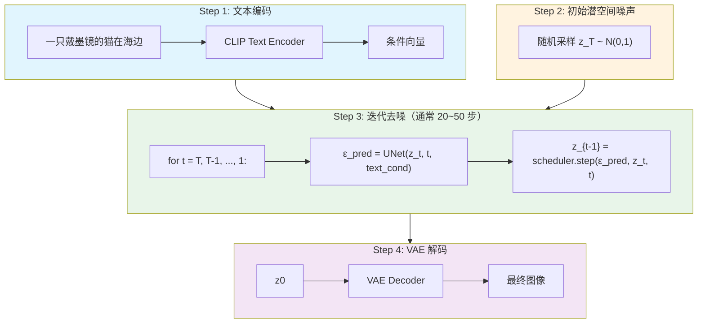
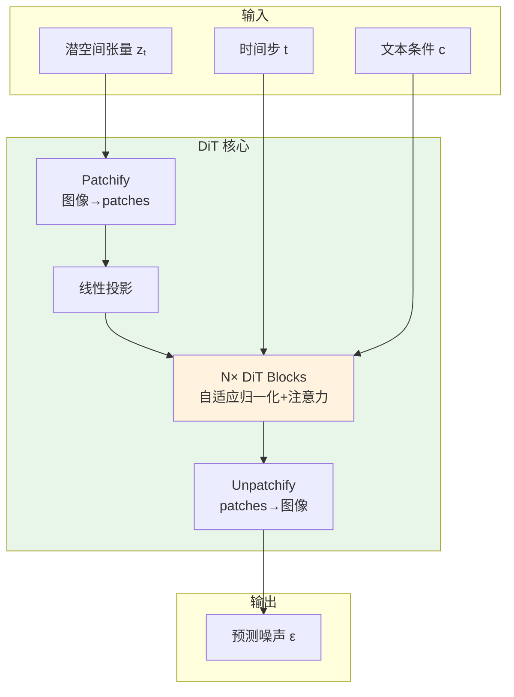
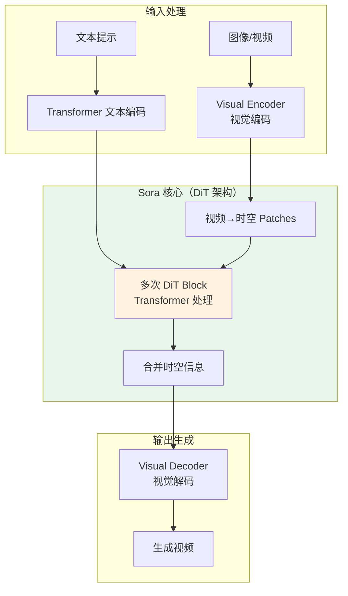
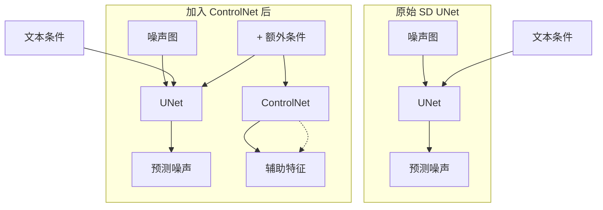
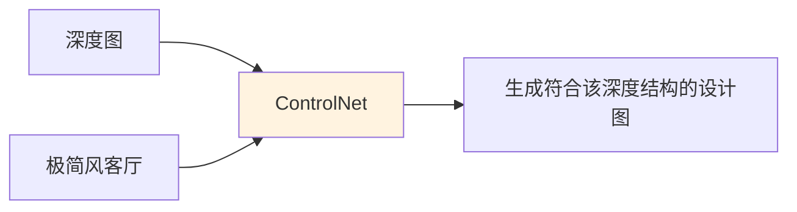
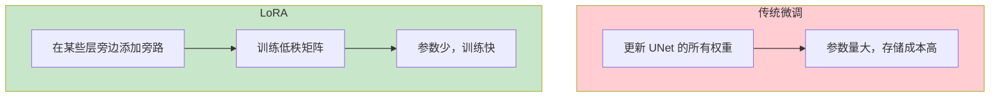
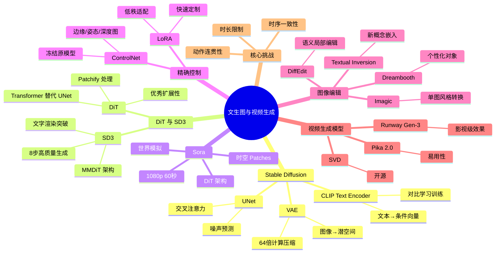

# 8-3 文生图与视频生成

## 学习目标

- 理解文生图（T2I）的工作原理与核心架构
- 掌握 Stable Diffusion 的三大组件：UNet、VAE、CLIP Text Encoder
- 了解 ControlNet、LoRA 等图像控制与微调技术
- 了解主流视频生成模型 Sora、Runway Gen、Pika 的技术路线
- 理解视频生成面临的核心挑战与未来方向

---

## 1. 文生图概述

**文生图（Text-to-Image，T2I）** 是生成式 AI 领域最受关注的应用之一：用户输入一段文字描述，模型生成与之对应的图像。

从技术演进角度看，文生图经历了以下阶段：

| 阶段 | 时间 | 代表模型 | 特点 |
|------|------|----------|------|
| GAN 时代 | 2017–2021 | StackGAN、CogView | 效果有限，生成质量不稳定 |
| 扩散模型崛起 | 2021–2022 | DALL·E 2、Stable Diffusion | 质量大幅提升，语义理解增强 |
| 指令跟随与可控生成 | 2023–2024 | SDXL、Stable Diffusion 3、FireDirector | 支持 ControlNet、LoRA 等精细控制；SD3 实现文字渲染突破 |
| Transformer 融合 | 2024– | SD3、DiT、Sora | Diffusion + Transformer 融合，架构统一化 |

---

## 2. Stable Diffusion 架构

**Stable Diffusion（SD）** 是最具影响力的开源文生图模型，由 Stability AI 发布。其核心架构由三部分组成：



### 2.1 CLIP Text Encoder

**CLIP（Contrastive Language-Image Pre-training）** 是 OpenAI 提出的多模态预训练模型，用于将图像和文本映射到同一语义空间。

在 Stable Diffusion 中：
- 使用 CLIP 的 Text Encoder（通常是一个 Transformer）将用户输入的文本提示（Prompt）编码为**条件向量**
- 这个条件向量在去噪过程中指导 UNet "生成什么样的图像"

CLIP 的核心训练目标是**对比学习**：将配对的图像-文本描述拉近，将不配对的拉远，使模型学会理解文本与图像之间的语义对应关系。

### 2.2 VAE（变分自编码器）

**VAE（Variational Autoencoder）** 在 Stable Diffusion 中负责两件事：

1. **编码（Encoder）**：将原始图像压缩到低维潜空间（latent space），降低计算量
2. **解码（Decoder）**：将潜空间中的信号解码为真实图像

为什么要在潜空间而非像素空间进行扩散？

> **直接在高分辨率像素空间进行扩散计算量巨大**（512×512 图像就有约 78 万维度）。VAE 将图像压缩到潜空间（比如 64×64），去噪计算量降低约 64 倍，效率大幅提升。

### 2.3 UNet（核心去噪网络）

**UNet** 是扩散模型的核心，负责"预测噪声"和"去噪"。

其结构特点：
- **编码器-解码器结构**：逐步下采样提取特征，逐步上采样恢复分辨率
- **跳跃连接（Skip Connections）**：保留底层细节信息，对图像生成至关重要
- **交叉注意力机制（Cross Attention）**：在去噪过程中融合 CLIP 提供的文本条件向量



---

## 3. 文生图完整流程

文生图的工作流程如下：



**关键概念说明：**

- **Prompt（提示词）**：用户输入的文本描述，是生成效果的核心控制信号
- **Negative Prompt（反向提示词）**：用户不希望出现的内容，比如"低质量"、"变形手指"
- **CFG（Classifier-Free Guidance）**：一种提升文本引导效果的技术，通过放大条件信号使生成结果更贴合文本描述
- **采样器（Sampler）**：执行去噪步骤的具体算法，如 Euler、Euler A、DPM++ 等，影响生成速度与效果

---

## 4. Diffusion Transformer (DiT) 与视频生成

**DiT（Diffusion Transformer）** 是扩散模型架构的重要演进，将 Vision Transformer（ViT）引入扩散过程，成为 Sora 等视频生成模型的基础架构。

### 4.1 DiT 简介

DiT 由 UC Berkeley 研究团队于 2022 年提出，核心思想是用 **Transformer 架构替代传统 UNet** 进行去噪预测。

| 特性 | UNet | DiT |
|------|------|-----|
| 架构基础 | 卷积神经网络（CNN） | Vision Transformer（ViT） |
| 参数量 | 相对较小 | 可扩展至超大参数 |
| 扩展性 | 有限 | 优秀（适合大模型） |
| 注意力机制 | 局部 + 交叉注意力 | 全局自注意力 |
| SOTA 成绩 | SD 2.x 等 | SD 3、图像生成新纪录 |

**DiT 的核心设计：**

1. **Patchify**：将图像切分为 patches（类似 ViT），每个 patch 线性嵌入为 token
2. **自适应层归一化（AdaLN）**：在 Transformer 块中加入条件信息（时间步 t、文本向量）
3. **选择器（Scaler）**：替代 AdaLN 的更高效条件融合方式



**DiT 的扩展性优势**：随着模型规模增大，DiT 的生成质量持续提升，而 UNet 容易达到瓶颈。这使其成为大规模生成模型的首选架构。

### 4.2 Stable Diffusion 3 (SD3)

**Stable Diffusion 3** 是 Stability AI 于 2024 年发布的最新版本，实现了架构重大升级：

**核心技术——MMDiT（Multi-Modal Diffusion Transformer）：**

- **MMDiT 架构**：分别处理文本和图像 token，保留各自语义空间的同时进行融合
- **文字渲染能力大幅提升**：SD3 之前，扩散模型在图像中生成准确文字一直是大难题；SD3 通过改进架构和训练显著改善
- **仅需 8 步即可生成高质量图像**：通过新的采样策略，显著加速推理

| 特性 | SD 2.x | SD 3 |
|------|--------|------|
| 核心架构 | UNet | MMDiT（MMDiT-X） |
| 文字渲染 | 较差 | 显著提升 |
| 生成步数 | 20~50 步 | 8~12 步即可 |
| 参数规模 | ~1B | 8B |
| 文字控制 | 弱 | 强 |

> SD3 的突破在于：文本编码器从 CLIP 扩展到 three-fold text encoders（OpenCLIP + CLIP + T5），更全面地理解文本语义。

### 4.3 Sora 技术分析

**Sora** 是 OpenAI 于 2024 年 2 月发布的视频生成模型，其架构正是基于 DiT 的扩展。

**核心设计：**



**关键技术点：**

1. **时空Patch（Spacetime Patches）**：将视频视为 3D 时空块（类似 DiT 处理 2D 图像的方式）
2. **Transformer 架构**：使用 Transformer 而非 UNet，支持大规模扩展
3. **Diffusion 过程**：沿用扩散模型的去噪生成范式
4. **可变分辨率/时长**：原生支持不同尺寸和长度的视频生成

**Sora 能力：**

| 能力 | 说明 |
|------|------|
| 1080p 视频 | 最长 60 秒 |
| 文生视频 | 文本描述生成视频 |
| 图生视频 | 静态图像动画化 |
| 视频编辑 | 视频风格转换、内容修改 |
| 世界模拟 | 展现出对物理世界的理解 |

> **注意**：Sora 的技术细节尚未完全公开，部分能力边界仍在探索中。

### 4.4 视频生成模型对比

| 模型 | 公司 | 架构 | 分辨率 | 时长 | 特点 |
|------|------|------|--------|------|------|
| **Sora** | OpenAI | DiT | 1080p | 60s | 世界模拟能力强，长视频 |
| **Runway Gen-3** | Runway | Diffusion | 1080p | 10s | 影视级效果，控制精确 |
| **Pika 2.0** | Pika Labs | Diffusion | 1080p | 10s | 操作简单，局部编辑强 |
| **SVD** | Stability AI | Diffusion | 576p | 4s | 开源，视频+音频联合 |
| **Kling** | 快手 | Diffusion+Transformer | 1080p | 3s | 国产，电商场景优化 |

**各模型特色：**

- **Sora**：引领架构创新（DiT），长视频能力突出，但尚未大规模开放
- **Runway Gen-3**：专注影视行业，强调镜头语言和运动控制
- **Pika 2.0**：用户体验友好，强调视频局部修改能力
- **SVD**：开源社区驱动，学术研究和二次开发友好

### 4.5 视频生成挑战与未来

**当前挑战：**

| 挑战 | 描述 | 解决方向 |
|------|------|----------|
| **时序一致性** | 帧间闪烁、主体漂移 | 跨帧注意力、光流约束 |
| **动作连贯性** | 复杂动作不够自然 | 物理先验、运动骨架引导 |
| **时长与计算** | 视频越长计算量越大 | 分段生成、关键帧插值 |
| **可控性** | 精确控制运动轨迹困难 | 姿态控制、轨迹控制 |
| **物理世界模拟** | 对重力、碰撞等理解有限 | 世界模型、增强学习 |

**未来方向：**

1. **更长视频**：通过分段续接、分层生成实现分钟级视频
2. **更高可控性**：结合 ControlNet 思想，实现精确的运动控制
3. **3D/4D 生成**：从 2D 视频扩展到 3D 场景和动态 4D 内容
4. **实时生成**：模型蒸馏、量化技术使推理达到实时水平
5. **音视频联合**：如 SVD 路线，实现声音与画面的同步生成

---

## 5. ControlNet：精确控制图像生成

**ControlNet** 是一种神经网络架构，用于以额外的条件信息来控制图像生成。

### 5.1 核心思想

ControlNet 在 Stable Diffusion 的 UNet 旁边添加了一个并行的"控制分支"：



ControlNet 冻结了原始 SD 的权重，只训练新增的控制分支，这使得：
- 预训练的强大生成能力得以保留
- 新增的条件控制可以快速学习（只需较少的训练数据和算力）

### 5.2 常见的 ControlNet 控制类型

| 控制类型 | 输入 | 效果 |
|----------|------|------|
| **Canny 边缘** | 图像的边缘线稿 | 按边缘轮廓生成图像 |
| **姿态（Pose）** | 人体骨架关键点 | 生成指定姿势的人物 |
| **深度图（Depth）** | 空间深度信息 | 保持景深关系生成新图像 |
| **法线图（Normal）** | 表面法线方向 | 保留表面凹凸细节 |
| **线稿（Lineart）** | 手绘或检测的线条 | 按线稿填充内容 |
| **语义分割（Seg）** | 区域分割掩码 | 区域内生成对应物体 |



---

## 6. LoRA：图像生成的微调技术

### 6.1 什么是 LoRA？

**LoRA（Low-Rank Adaptation）** 最初由微软提出，用于大语言模型的高效微调，后被广泛应用于图像生成模型的定制化。

LoRA 的核心思想是：**不训练完整的大模型权重，而是训练低秩矩阵来调整模型行为**。

### 6.2 在图像生成中的应用

在 Stable Diffusion 中，LoRA 被用于：

1. **人物角色定制**：训练特定人物的特征（比如某个真实人物或 IP 角色）
2. **艺术风格迁移**：学习某种艺术风格（动漫、水彩、赛博朋克等）
3. **服装与物件**：生成特定服装、道具、产品的能力



LoRA 文件通常只有几十到几百 MB，远小于完整模型（通常数 GB），便于分享和使用。

---

## 7. 扩散模型图像编辑技术

除了从零生成图像，扩散模型还能**编辑现有图像**。以下是三种主流技术：

### 7.1 Dreambooth：个性化对象生成

**Dreambooth**（Google, 2022）允许用户用 3-5 张特定对象的照片，训练一个定制化的扩散模型，使其能生成该对象在不同场景中的图像。

**原理**：
- 选择一个稀有标识符（如 "sks"）作为对象的名称
- 在训练时同时保留原模型的先验知识（通过类别先验保存损失）
- 防止过拟合到特定背景

**应用**：生成宠物/人物/产品的艺术化照片、虚拟形象。

### 7.2 Textual Inversion：无需训练的新概念

**Textual Inversion**（2022）更进一步：它**不修改模型权重**，而是学习一个新的文本嵌入向量来代表新概念。

**原理**：
- 冻结整个扩散模型
- 只优化一个新的词嵌入（如 `<new-concept>`）
- 该嵌入被引导到能重建目标图像的语义方向

**优势**：无需微调大模型，仅需几分钟训练，模型文件仅几 KB。

### 7.3 DiffEdit 与 Imagic：语义图像编辑

**DiffEdit**（NVIDIA, 2022）实现"指哪改哪"：用户提供一个目标文本描述，DiffEdit 自动推断需要修改的图像区域（通过对比原始文本和目标文本的注意力图生成掩码），然后仅在该区域内进行扩散去噪。

**Imagic**（Google, 2022）则只需一张图和一个目标文本，就能编辑图像。它先找到该图像在扩散模型中的文本嵌入，然后向目标文本的嵌入方向微调，同时保持原图像的整体结构。

| 技术 | 训练需求 | 修改对象 | 典型应用 |
|------|----------|----------|----------|
| **Dreambooth** | 微调整个 UNet | 模型权重 | 个性化角色/产品 |
| **Textual Inversion** | 仅优化嵌入向量 | 新词嵌入 | 快速概念学习 |
| **DiffEdit** | 无需训练 | 推理时掩码 | 局部语义编辑 |
| **Imagic** | 单图嵌入微调 | 文本嵌入 | 单图风格/内容转换 |

## 8. 其他文生图模型简介

### 8.1 DALL·E 系列

**DALL·E**（OpenAI）是最早引起广泛关注的文生图模型之一：

| 版本 | 发布时间 | 关键特点 |
|------|----------|----------|
| DALL·E 1 | 2021.01 | 基于 GPT-3 + VQ-VAE，闭源发布 |
| DALL·E 2 | 2022.04 | 引入 CLIP 指导，生成质量提升，闭源 |
| DALL·E 3 | 2023.09 | 深度集成 ChatGPT，提示词理解能力大幅提升 |

### 8.2 Midjourney

**Midjourney** 以其出色的艺术效果著称，通过 Discord 交互使用：

- **优势**：艺术感强，色彩和构图优秀，适合创意设计
- **局限**：提示词控制相对不精确，长文本支持有限
- **版本**：持续迭代，V6 版本在写实和文字生成方面有明显进步

### 8.3 Adobe Firefly

**Adobe Firefly** 定位为"创意辅助工具"，深度集成到 Photoshop 等 Adobe 产品中：

- 强调**商业安全**，训练数据来自授权内容
- 与 Adobe 生态深度整合，适合设计师工作流

---

## 9. 视频生成模型

视频生成是比图像生成更具挑战性的任务：需要同时建模**空间内容**和**时间维度的连续性**。

### 9.1 主要模型概览

| 模型 | 公司/团队 | 技术路线 | 特点 |
|------|-----------|----------|------|
| **Sora** | OpenAI | Diffusion + Transformer | 长视频（最长1分钟），世界模拟能力强 |
| **Runway Gen** | Runway | Diffusion | 影视级效果，控制精确，商用成熟 |
| **Pika** | Pika Labs | Diffusion | 操作简单，支持角色/场景定制 |
| **SVD（Stable Video Diffusion）** | Stability AI | Diffusion | 开源，视频+音频联合生成 |

### 9.2 Sora 的技术思路

**Sora** 是 OpenAI 于 2024 年初发布的视频生成模型，引发了广泛讨论。

Sora 采用了类似文生图的**扩散模型**路线，但扩展到时间维度：

- 将视频视为"时空中的像素块（patches）"，类似 Token 化处理
- 使用 **Transformer 架构**（而非传统 UNet）处理时空块
- 在大规模视频数据上训练，涌现出"世界模拟"能力

> **注意**：截至本教材编写时，Sora 尚未完全公开开放，部分技术细节仍以技术报告形式发布。

### 9.3 Runway 与 Pika

**Runway** 在影视行业有广泛应用，其 Gen 系列模型：
- 强调镜头语言的理解与控制
- 支持运动笔刷（Motion Brush）等直观的控制方式

**Pika** 以易用性著称：
- 上传图片或视频片段，输入文字即可编辑
- 支持局部修改（比如"把老人的白发变成黑发"）

---

## 10. 视频生成的核心挑战

视频生成比图像生成难得多，以下是主要挑战：

### 10.1 时序一致性

| 问题 | 描述 | 解决思路 |
|------|------|----------|
| 闪烁（Flickering） | 帧与帧之间出现明显的纹理跳变 | 时序建模层、跨帧注意力机制 |
| 主体身份漂移 | 人物或物体在连续帧中外观变化 | 引入参考图像（Reference）作为条件 |
| 动作不连贯 | 运动轨迹出现跳帧或卡顿 | 光流引导、运动平滑处理 |

### 10.2 动作连贯性

生成流畅的运动动作（如人物行走、物体飘动）需要模型理解物理规律和运动惯性。

当前解决方法包括：
- **光流（Optical Flow）约束**：要求相邻帧之间的变化符合光流预测
- **物理先验**：引入物理引擎辅助判断合理性
- **多模态输入**：结合姿态、骨骼等结构化信息引导生成

### 10.3 时长限制

| 现状 | 说明 |
|------|------|
| 大多数模型限制在 3~10 秒 | 计算量随视频时长线性增长 |
| Sora 可达 1 分钟 | 以牺牲部分控制精度为代价 |

未来方向：
- **视频续接（Video Extension）**：先生成短片段，再无缝续接
- **分层生成**：先规划关键帧，再插值中间帧

---

## 11. 多模态生成的未来展望

### 11.1 当前趋势

1. **生成控制越来越精细**：从粗粒度的文本到草图、深度图、姿态等多模态条件
2. **模型轻量化**：LoRA、量化等技术使定制模型可以在消费级显卡上运行
3. **统一多模态架构**：如 GPT-4V、Gemini 等多模态大模型，开始统一图像、视频、文本的理解与生成

### 11.2 未来方向

```
┌─────────────────────────────────────────────────────────────┐
│                  多模态生成未来展望                           │
├─────────────────────────────────────────────────────────────┤
│                                                             │
│  • 实时生成：模型推理速度提升，支持实时视频编辑               │
│  • 3D 一致性：从 2D 图像生成扩展到 3D 场景和物体              │
│  • 交互式生成：用户通过多轮对话持续修改生成结果               │
│  • 视频中声音同步生成：音视频联合生成（如 SVD 路线）         │
│  • 个性化模型：每个人训练自己的专属生成风格                   │
│                                                             │
└─────────────────────────────────────────────────────────────┘
```

### 11.3 潜在影响

文生图与视频生成技术正在深刻影响以下行业：

| 行业 | 影响 |
|------|------|
| 广告与营销 | 降低创意素材制作成本，快速生成多版本 |
| 影视与游戏 | 加速概念设计、场景预览、辅助拍摄 |
| 教育与培训 | 生成可视化教学材料，降低内容制作门槛 |
| 时尚与电商 | 虚拟试穿、产品展示图生成，降低拍摄成本 |

---

---

## 本章小结

本章围绕文生图与视频生成技术展开，介绍了以下核心内容：

1. **Stable Diffusion 架构**：由 CLIP Text Encoder（文本编码）、VAE（变分自编码器，潜空间压缩）、UNet（去噪网络）三大组件构成。在潜空间进行扩散大幅降低了计算复杂度，是文生图高效生成的关键。

2. **DiT 与 SD3**：DiT 将 Transformer 架构引入扩散模型，成为视频生成的基础。Stable Diffusion 3 采用 MMDiT 架构，实现文字渲染突破，仅需 8 步即可生成高质量图像。

3. **Sora 技术**：基于 DiT 的视频生成模型，支持 1080p 60 秒视频生成，展现出世界模拟能力。

4. **ControlNet 控制技术**：在冻结原 SD 模型的基础上添加控制分支，通过边缘图、姿态、深度图等多种条件信号实现精确的图像生成控制。

5. **LoRA 微调技术**：通过低秩矩阵高效微调大模型，以极小的参数量实现人物角色、艺术风格等的定制化训练。

6. **扩散模型图像编辑**：Dreambooth（个性化对象生成）、Textual Inversion（无需微调的新概念学习）、DiffEdit（语义局部编辑）、Imagic（单图风格转换）等技术，让扩散模型不仅能生成，还能精准编辑现有图像。

7. **视频生成挑战**：时序一致性（防止闪烁、主体漂移）、动作连贯性（理解物理规律）、时长限制是三大核心挑战。Sora、Runway Gen-3、Pika 2.0 等模型各具特色，代表了不同的技术路线。


## 知识图谱



---

## 参考资料

1. Rombach, R. et al. "High-Resolution Image Synthesis with Latent Diffusion Models." *CVPR*, 2022.
2. Ho, J. et al. "Denoising Diffusion Probabilistic Models." *NeurIPS*, 2020.
3. Zhou, L. et al. "ControlNet: Adding Conditional Control to Text-to-Image Diffusion Models." *arXiv*, 2023.
4. Hu, E. et al. "LoRA: Low-Rank Adaptation of Large Language Models." *ICLR*, 2022.
5. OpenAI. "Video Generation Models as World Simulators." *Sora Technical Report*, 2024.
6. Zhang, C. et al. "Stable Video Diffusion." *arXiv*, 2023.
8. Peebles, W. & Xie, S. "Scalable Diffusion Models with Transformers." *ICCV*, 2023. (DiT)
9. Esser, P. et al. "Scaling Rectified Flow Transformers for High-Resolution Image Synthesis." *arXiv*, 2024. (SD3)

---
