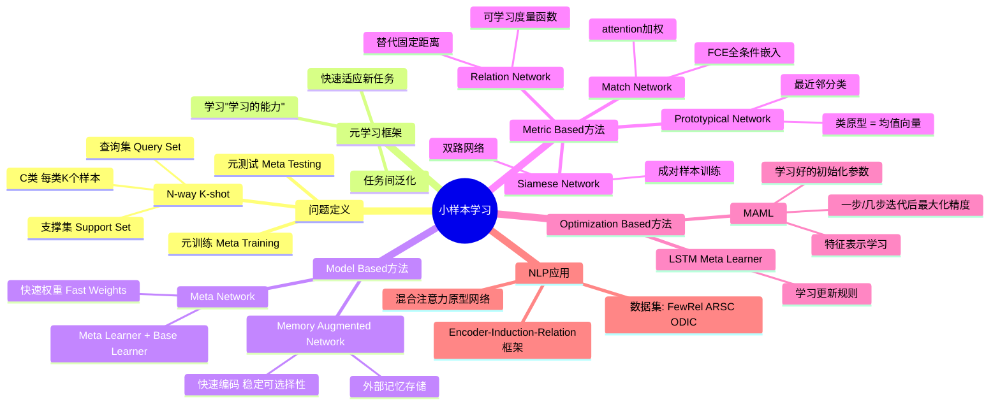

# 9-1 小样本学习与元学习

## 学习目标

- 理解小样本学习（Few-shot Learning）的定义与核心思想
- 掌握 N-way K-shot 问题的形式化定义
- 理解元学习（Meta Learning）的概念及其与Few-shot Learning的关系
- 掌握三类经典方法：Model Based、Metric Based、Optimization Based
- 深入理解MAML和Prototypical Networks的原理

---

## 1. 小样本学习概述

### 1.1 什么是小样本学习

人类非常擅长通过极少量的样本识别一个新物体。例如，小孩子只需要看几幅图片就能认识什么是"斑马"，什么是"犀牛"。在人类快速学习能力的启发下，研究人员希望机器学习模型在学习了一定类别的大量数据后，对于新的类别，只需要少量的样本就能快速学习——这就是**小样本学习（Few-shot Learning）**要解决的问题。

在真实场景中，小样本学习有着广泛的应用需求。以智能对话系统为例，平台用户创建一个新的对话任务时，每个意图往往只有几个或十几个标注样本，传统的深度学习方法在这种数据稀缺的情况下很容易过拟合。

### 1.2 N-way K-shot 问题

小样本学习的标准形式化定义如下：

**元训练阶段（Meta Training）**：从训练集中随机抽取 C 个类别，每个类别抽取 K 个样本（总共 C×K 个数据），构建一个 meta-task 作为**支撑集（Support Set）**；再从这 C 个类别的剩余数据中抽取一批样本作为**批处理集（Batch Set）**。模型需要从 C×K 个数据中学会区分这 C 个类别。

**元测试阶段（Meta Testing）**：面对全新的类别，不需要变动已有的模型，即可完成分类。

> **这种任务被称为 C-way K-shot 问题**：
> - **C-way**：有多少个类别需要区分（即 C 个类别）
> - **K-shot**：每个类别有多少个样本（即每类 K 个样本）

例如，**2-way 5-shot** 意味着：给定 2 个类别，每个类别 5 个样本（共 10 个样本）作为支撑集，要求模型对新的测试样本进行分类。

每次训练（episode）都会采样得到不同的 meta-task，这种机制使得模型学会不同 meta-task 中的共性部分，比如如何提取重要特征及比较样本相似度等。

---

## 2. 元学习：学会学习

### 2.1 元学习的核心思想

**元学习（Meta Learning）**，又称 learning to learn，是小样本学习的理论基础。元学习的关键思想是：

- **Meta Training 阶段**：将数据集分解为不同的 meta-task，去学习类别变化情况下模型的泛化能力
- **Meta Testing 阶段**：面对全新的类别，无需变动已有模型，就可以完成分类

元学习认为，学习的本质是学会"学习的能力"——不是从零开始学习一个任务，而是学习如何快速学习新任务。

### 2.2 元学习与Few-shot Learning的关系

Few-shot Learning 是 Meta Learning 在监督学习领域的具体应用。元学习的框架为小样本学习提供了理论支撑和方法论指导，使得模型能够在极少量样本上快速适应新任务。

---

## 3. 小样本学习的三类方法

### 3.1 方法分类概览

小样本学习模型大致可分为三类：

| 方法类型 | 核心思想 | 代表性模型 |
|---------|---------|-----------|
| **Model Based** | 通过模型结构设计快速在少量样本上更新参数 | Memory Augmented Network、Meta Network |
| **Metric Based** | 通过度量样本间距离，借助最近邻思想完成分类 | Siamese Network、Match Network、Prototypical Network、Relation Network |
| **Optimization Based** | 调整优化方法，使梯度下降能在少量样本下拟合 | MAML、LSTM Meta Learner |

---

## 4. Model Based 方法

### 4.1 Memory Augmented Network

Santoro 等人提出使用**记忆增强（Memory Augmented）**的方法来解决 Few-shot Learning 任务。其核心思想基于神经网络图灵机（NTMs），通过外部存储（External Memory）进行短时记忆，并通过缓慢权值更新进行长时记忆。

**关键技术点**：
- 外部记忆存储：解决了循环神经网络内部记忆单元无法扩展到大量新信息编码的问题
- 快速编码：让存储在记忆中的表达既**稳定**（需要时可可靠访问）又**可选择性访问**（选择性地访问相关信息）
- 参数约束：参数数量不受内存大小束缚

### 4.2 Meta Network

Meta Network 的快速泛化能力源自其**"快速权重（Fast Weights）"**机制。在训练过程中产生的梯度被用来作为快速权重的生成信号。

**网络结构**：
- **Meta Learner**：用于学习 meta task 之间的泛化信息，使用 memory 机制保存这种信息
- **Base Learner**：用于快速适应新的 task，与 meta learner 交互产生预测输出

---

## 5. Metric Based 方法

度量学习方法是小样本学习中最受欢迎的研究方向，其核心是通过学习样本间的距离度量来完成分类。

### 5.1 孪生网络（Siamese Network）

Koch 等人提出的孪生网络是度量学习的开创性工作。

**网络结构**：
- 一个双路的神经网络
- 训练时，通过组合方式构造不同的成对样本
- 最上层通过样本对的距离判断是否属于同一类，并产生概率分布

**预测阶段**：孪生网络处理测试样本和支撑集之间每一个样本对，最终预测结果为支撑集上概率最高的类别。

### 5.2 匹配网络（Match Network）

Match Network 为支撑集和 Batch 集构建不同的编码器，最终分类器的输出是支撑集样本和 Query 之间预测值的加权求和。

**主要创新**：
1. **建模创新**：提出基于 memory 和 attention 的 matching nets
2. **训练创新**：训练时不断让网络只看每类的少量样本，与测试过程保持一致

**分类概率计算**：
对于一个新数据，其分类概率由与支撑集 S 之间的距离度量得出，通过 attention score 加权求和得到最终预测。

**Fully-Conditional Embedding (FCE)**：
- 基于双向 LSTM 学习训练集的 embedding
- 基于 attention-LSTM 对测试样本 embedding，使得 Query 样本的 embedding 是支撑集 embedding 的函数

### 5.3 原型网络（Prototypical Network）

原型网络基于这样的核心想法：**每个类别都存在一个原型表达（Prototype）**，该类的原型是 support set 在 embedding 空间中的均值。然后，分类问题变成在 embedding 空间中的最近邻。

**工作原理**：
1. 对每个类别，计算其所有样本在 embedding 空间中的均值作为原型
2. 将测试样本 x 进行 embedding 后，与各个类别的原型进行距离计算
3. 距离最近的原型对应的类别即为预测结果

**训练技巧**：训练时采用相对测试时更多的类别数（如训练时 20-way，测试时 5-way），实验表明可以提升约 2.5 个百分点的准确率。

### 5.4 关系网络（Relation Network）

前面的方法在最终的距离度量上都使用了**固定的度量方式**（如 cosine、欧式距离等），所有学习过程都发生在样本的 embedding 阶段。

Relation Network 的核心观点是：**度量方式也是网络中非常重要的一环，需要对其进行建模**。因此，该网络训练一个专门的网络来学习距离度量方式。

**损失函数**：由于关系网络更关注 relation score（更像回归任务），使用 MSE 取代了 cross-entropy。

---

## 6. Optimization Based 方法

### 6.1 问题背景

基于梯度的优化算法（包括 momentum、adagrad、adadelta、ADAM 等）在少量数据下存在以下问题：

1. 无法在几步内完成优化，特别是在非凸问题上
2. 多种超参的选取无法保证收敛速度
3. 不同任务分别随机初始化会影响收敛到好的解

### 6.2 LSTM Meta Learner

Ravi 等人提出学习一个模型参数的更新函数或更新规则。其核心思想是：采用 LSTM 表达 meta learner，用其状态表达目标分类器的参数更新，最终学会如何在新的分类任务上对分类器网络进行初始化和参数更新。

**Meta Learner 的目标**：在各种不同的学习任务上学出一个模型，使得仅用少量样本就能解决一些新的学习任务。

### 6.3 MAML（Model-Agnostic Meta-Learning）

Finn 等人提出的 MAML 是最具影响力的元学习方法之一。

**核心思想**：学习模型的**初始化参数**，使得在一步或几步迭代后在新任务上的精度最大化。

**关键特点**：
- 不学习模型参数的更新函数或规则
- 不局限于参数的规模和模型架构
- 本质上是学习一个好的特征表示，使得可以适合很多任务
- 通过 fine-tune 获得好的效果，无需为 meta learning 增加新参数

**目标**：找到一些对任务变化敏感的参数，使得当改变梯度方向时，小的参数改动也会产生较大的 loss——这意味着能够快速适应新任务。

---

## 7. 自然语言处理中的应用

### 7.1 主要数据集

| 数据集 | 描述 |
|-------|------|
| **FewRel** | EMNLP 2018提出，64种关系用于训练，16种用于验证，20种用于测试，每种关系700个样本 |
| **ARSC** | NAACL 2018提出，23种亚马逊商品评论数据，23×3=69个task |
| **ODIC** | 来自阿里巴巴对话工厂平台，216个意图，159个用于训练，57个用于测试 |

### 7.2 典型模型改进

**基于混合注意力的原型网络**：文本与图像的一大区别在于多样性和噪声更大。该方法提出：
- **Instance-level attention**：从支撑集中选出和 query 更为贴近的实例
- **Feature-level attention**：衡量特征空间中哪些维度对分类更重要

**Encoder-Induction-Relation 三级框架**：
- **Encoder 模块**：获取样本的语义表示（CNN、LSTM、Transformer等）
- **Induction 模块**：从支撑集样本语义中归纳出类别特征
- **Relation 模块**：度量 query 和类别之间的语义关系，完成分类

---

## 8. 本章小结

小样本学习是机器学习领域的重要研究方向，其核心挑战在于如何利用极少量样本快速学习新类别。元学习为这一任务提供了"学会学习"的理论基础。

三类主流方法各有优势：
- **Metric Based** 方法简洁高效，是目前研究和应用的主流
- **Optimization Based** 方法（尤其是MAML）具有极强的泛化能力
- **Model Based** 方法通过记忆机制实现快速学习

在实际应用中，Encoder-Induction-Relation 框架体现了从样本表示到类别表示的显式建模，是解决自然语言处理中小样本分类问题的重要进展。

---

## 知识点思维导图

---

## 参考资料

1. Lake, B. M., et al. (2011). One shot learning of simple visual concepts. *CogSci*.
2. Vinyals, O., et al. (2016). Matching networks for one shot learning. *NeurIPS*.
3. Santoro, A., et al. (2016). One-shot learning with memory-augmented neural networks. *arXiv preprint arXiv:1605.06065*.
4. Koch, G., et al. (2015). Siamese neural networks for one-shot image recognition. *ICML Deep Learning Workshop*.
5. Snell, J., et al. (2017). Prototypical networks for few-shot learning. *NeurIPS*.
6. Sung, F., et al. (2018). Learning to compare: Relation network for few-shot learning. *CVPR*.
7. Ravi, S., & Larochelle, H. (2016). Optimization as a model for few-shot learning. *ICLR*.
8. Finn, C., et al. (2017). Model-agnostic meta-learning for fast adaptation of deep networks. *ICML*.
9. Geng, R., et al. (2019). Few-Shot Text Classification with Induction Network. *arXiv preprint arXiv:1902.10482*.
10. Han, X., et al. (2018). FewRel: A Large-Scale Supervised Few-Shot Relation Classification Dataset. *EMNLP*.