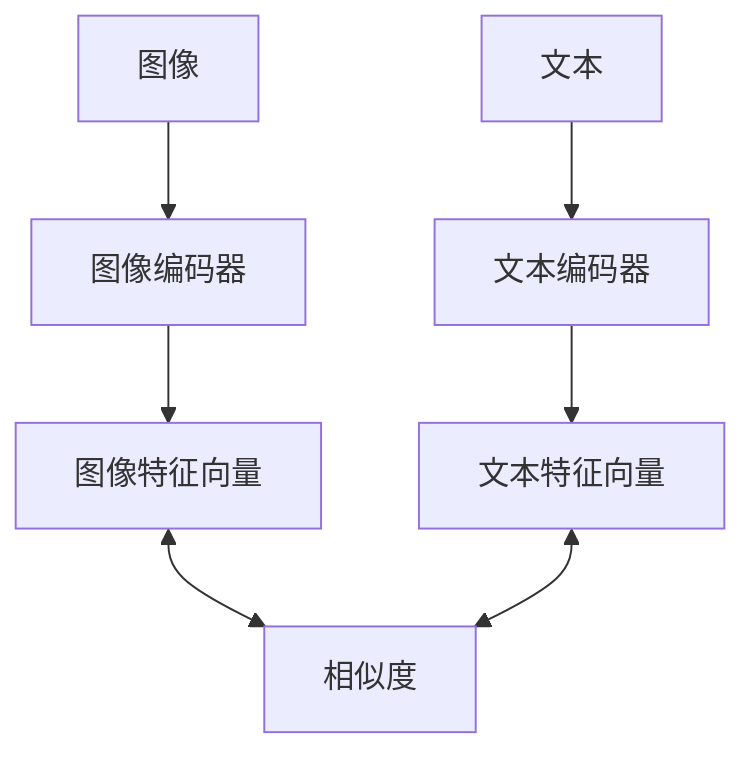
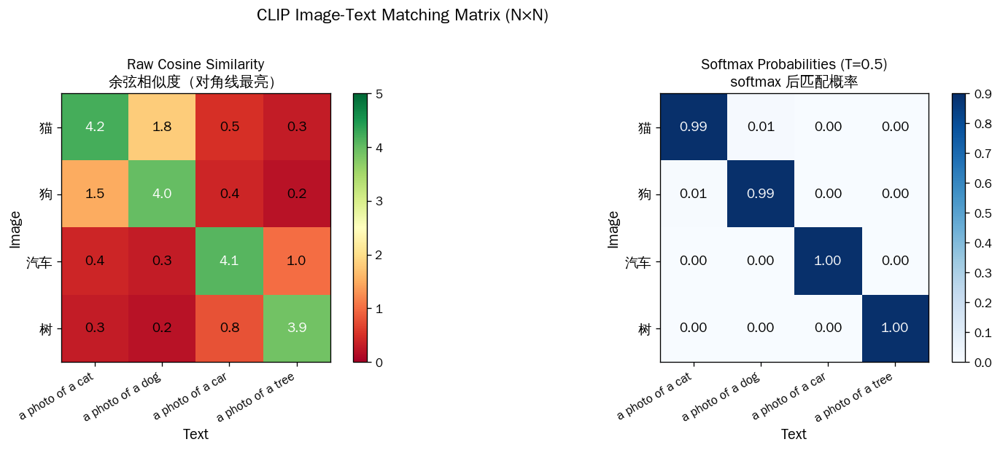
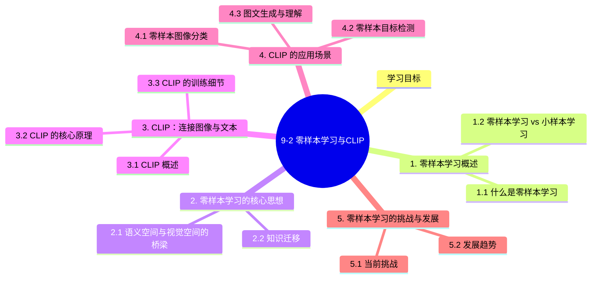

# 9-2 零样本学习与CLIP

## 学习目标

- 理解零样本学习（Zero-shot Learning）的定义与应用场景
- 掌握CLIP的核心原理：对比学习与图文配对
- 理解CLIP如何实现零样本分类与检测
- 了解多模态学习的演进方向

---

## 1. 零样本学习概述

### 1.1 什么是零样本学习

**零样本学习（Zero-shot Learning）** 是小样本学习的极端情况——在面对全新类别时，**没有任何该类别的训练样本**。模型必须利用已有的知识（如类别描述、属性特征等）来识别从未见过的类别。

**典型场景**：
- 识别一个从未见过的动物种类（仅知道其文字描述）
- 分类文本情感，但某些情感类别在训练时从未出现
- 目标检测中检测全新类别的物体

### 1.2 零样本学习 vs 小样本学习

| 对比维度 | 小样本学习 (Few-shot) | 零样本学习 (Zero-shot) |
|---------|---------------------|---------------------|
| 训练样本 | 极少（1-5个/类） | 无（0个/类） |
| 学习方式 | 基于相似度度量 | 基于知识迁移/语义表示 |
| 核心挑战 | 如何从少量样本中提取有效特征 | 如何利用已有知识泛化到新类别 |

---

## 2. 零样本学习的核心思想

### 2.1 语义空间与视觉空间的桥梁

零样本学习的核心思想是构建**语义空间**与**视觉空间**之间的桥梁：

1. **语义空间**：每个类别由一组属性或文本描述表示（如"有翅膀"、"会飞"、"体型大"）
2. **视觉空间**：实际图像的特征表示
3. **映射学习**：学习从视觉空间到语义空间的映射，或学习共享的嵌入空间

### 2.2 知识迁移

模型利用从训练类别学到的知识，通过以下方式迁移到新类别：
- **属性预测**：先预测图像具有哪些属性，再根据属性判断类别
- **词向量迁移**：利用预训练词向量（如Word2Vec、GloVe）的类别语义关系
- **文本描述匹配**：将图像与类别的文本描述进行匹配

---

## 3. CLIP：连接图像与文本

### 3.1 CLIP 概述

**CLIP（Contrastive Language-Image Pre-training）** 是 OpenAI 于2021年提出的多模态模型，其核心贡献是：

> 通过大规模的**图文对比学习**，构建了一个能够理解图像和文本统一表示的模型，首次实现了高质量的**零样本图像分类**。

### 3.2 CLIP 的核心原理

#### 3.2.1 对比学习图文配对

CLIP 的训练数据是互联网上收集的**图像-文本配对**（4亿对），训练目标是：

**给定一个batch中的N个图像和N个文本描述，CLIP学习识别出哪一幅图像配哪一个文本。**

训练时：
- 图像编码器（Image Encoder）提取图像特征
- 文本编码器（Text Encoder）提取文本特征
- 计算每对图文之间的相似度，形成一个 N×N 的矩阵
- 对角线上的配对是正确匹配，目标是最小化对角线上配对的相似度，最大化其他错误配对的相似度

这种**对比学习（Contrastive Learning）**方式不需要手工标注的分类标签，只需图文配对数据。

#### 3.2.2 双编码器架构



- **图像编码器**：可以使用 ResNet、Vision Transformer (ViT) 等架构
- **文本编码器**：使用 Transformer 架构
- 两个编码器输出投影到统一的多模态嵌入空间

#### 3.2.3 零样本分类能力

CLIP 之所以能够实现零样本分类，关键在于：

1. **预训练阶段**：学习图像和文本的**统一表示**，文本描述可以是任意组合的词语
2. **推理阶段**：将所有候选类别的文本描述（如"狗的照片"、"猫的照片"）编码为文本向量
3. **分类**：计算图像向量与所有文本向量的相似度，选择相似度最高的类别作为预测结果

这意味着：**CLIP不需要在特定数据集上训练，就能进行各种分类任务！**

### 3.3 CLIP 的训练细节

| 细节 | 说明 |
|-----|------|
| **训练数据** | 4亿图像-文本配对，来自互联网 |
| **对比学习** | InfoNCE loss，优化图像-文本对的相似度 |
| **批量大小** | 32768（大规模batch） |
| **温度参数** | 可学习的温度参数 τ |
| **图像增强** | 仅使用随机裁剪和水平翻转 |
| **训练效率** | 从头训练，不使用任何预训练图像编码器 |

下图展示 CLIP 的 $N \times N$ 图像-文本匹配矩阵（左：原始余弦相似度；右：softmax 后匹配概率）：



---

## 4. CLIP 的应用场景

### 4.1 零样本图像分类

CLIP 可以直接用于分类任意类别，只需提供类别的文本描述：

```python
# 示例：将类别文本编码为向量
text_descriptions = ["a photo of a cat", "a photo of a dog", "a photo of a bird"]
text_features = clip.encode_text(text_descriptions)

# 对新图像进行分类
image_features = clip.encode_image(image)
similarity = cosine_similarity(image_features, text_features)
predicted_class = text_descriptions[similarity.argmax()]
```

### 4.2 零样本目标检测

CLIP 的思想也被扩展到目标检测任务：
- 通过文本描述指定要检测的类别
- 无需在特定数据集上训练检测器
- 可以检测训练时从未见过的物体类别

### 4.3 图文生成与理解

CLIP 为后续的多模态模型（如 DALL·E、Stable Diffusion）奠定了基础：
- DALL·E 使用 CLIP 对生成的图像进行排序
- Stable Diffusion 使用 CLIP 作为文本-图像对齐的监督信号

---

## 5. 零样本学习的挑战与发展

### 5.1 当前挑战

| 挑战 | 描述 |
|-----|------|
| **语义鸿沟** | 视觉特征与语义特征之间的映射仍有差距 |
| **领域偏移** | 训练领域与测试领域差异大时性能下降 |
| **属性获取** | 为每个新类别获取有效的文本描述并非易事 |
| **长尾问题** | 稀有类别的文本描述可能信息不足 |

### 5.2 发展趋势

1. **更大规模的预训练**：更多图文对数据带来更强的零样本能力
2. **多模态融合**：CLIP启发了更多统一视觉和语言的大模型
3. **跨模态迁移**：从文本-图像迁移到音频-文本、视频-文本等领域
4. **Prompt Engineering**：通过精心设计文本提示（Prompt）提升零样本性能

---

## 本章小结
零样本学习和CLIP代表了人工智能从"监督学习"向"开放世界识别"的重要跨越：

- **零样本学习**通过语义空间桥梁，让模型能够识别从未见过的类别
- **CLIP**通过大规模的图文对比学习，实现了真正泛化的视觉理解
- CLIP的成功证明了"文本监督"可以作为一种有效的学习信号

CLIP的零样本能力来源于：
1. 海量多样化的训练数据
2. 统一的多模态嵌入空间
3. 自由形式的文本描述（而非固定的类别标签）

这为后续的大模型多模态学习奠定了重要基础。


## 知识图谱



## 参考资料

1. Radford, A., et al. (2021). Learning Transferable Visual Models From Natural Language Supervision. *ICML*.
2. Brown, T. B., et al. (2020). Language Models are Few-Shot Learners. *NeurIPS*.
3. Devlin, J., et al. (2018). BERT: Pre-training of Deep Bidirectional Transformers for Language Understanding. *NAACL*.
4. Dosovitskiy, A., et al. (2020). An Image is Worth 16x16 Words: Transformers for Image Recognition at Scale. *ICLR*.
5. Rombach, R., et al. (2022). High-Resolution Image Synthesis with Latent Diffusion Models. *CVPR*.
