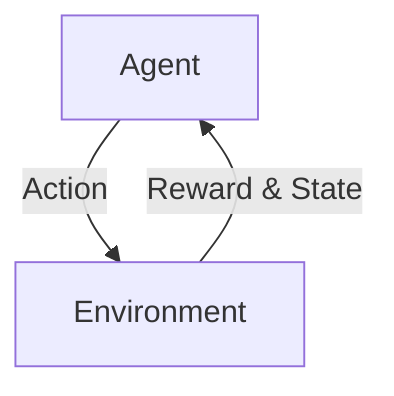
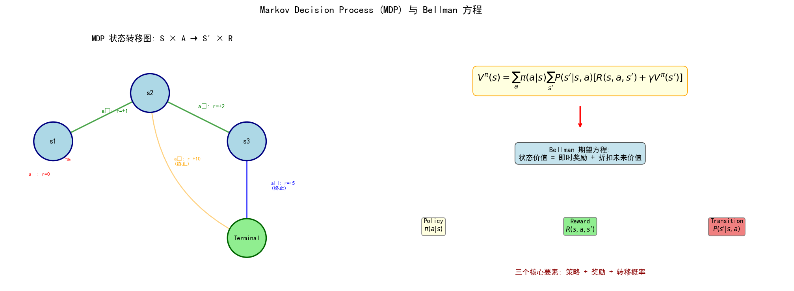
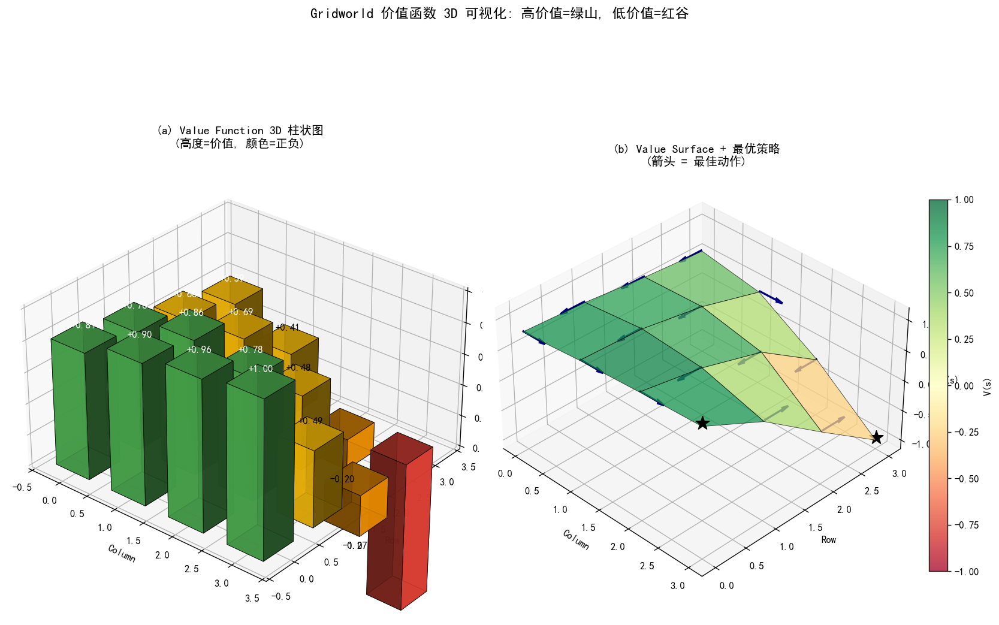
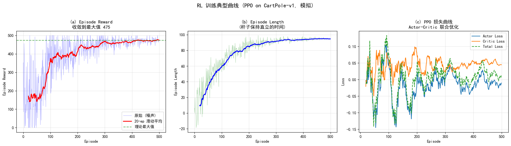
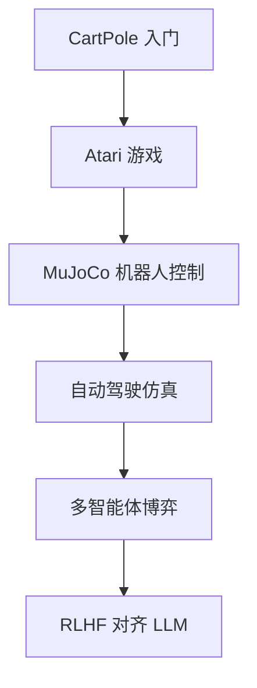
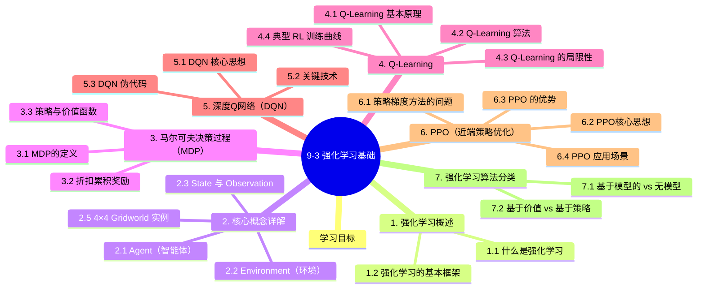

# 9-3 强化学习基础

## 学习目标

- 理解强化学习的基本概念：Agent、Environment、State、Action、Reward
- 掌握马尔可夫决策过程（MDP）的核心要素
- 理解Q-Learning的基本原理和算法流程
- 掌握深度Q网络（DQN）的核心思想与改进
- 了解PPO算法的基本原理和应用

---

## 1. 强化学习概述

### 1.1 什么是强化学习

**强化学习（Reinforcement Learning, RL）** 是一种通过与环境交互来学习决策策略的机器学习范式。与监督学习不同，强化学习没有明确的"标签"，而是通过**试错（Trial and Error）**和**延迟奖励（Delayed Reward）**来学习。

**核心思想**：智能体（Agent）在环境中执行动作，根据获得的奖励或惩罚信号来调整策略，最终学会在特定状态下选择最优动作。

### 1.2 强化学习的基本框架

强化学习的基本框架包含以下核心要素：





> 📊 完整代码：[`assets/figures/9-3-mdp-state-graph.py`](../../assets/figures/9-3-mdp-state-graph.py)

**交互过程**：
1. Agent 观察 Environment 的当前**状态（State）**
2. Agent 根据策略选择并执行一个**动作（Action）**
3. Environment 响应动作，转移到新状态，并给 Agent 提供**奖励（Reward）**
4. Agent 根据奖励更新策略

---

## 2. 核心概念详解

### 2.1 Agent（智能体）

Agent 是强化学习中的决策者，可以是：
- 游戏中的AI角色
- 机器人控制系统
- 自动驾驶决策模块
- 推荐系统

Agent 的目标是学习一个**策略（Policy）**π，使得长期累积奖励最大化。

### 2.2 Environment（环境）

Environment 是 Agent 所在并与之交互的外部系统：
- 物理环境（机器人所在的世界）
- 虚拟环境（游戏、模拟器）
- 抽象环境（金融市场、对话系统）

### 2.3 State 与 Observation

| 概念 | 说明 |
|-----|------|
| **State (s)** | 环境的完整状态描述 |
| **Observation (o)** | Agent 观察到的部分状态信息 |

当 Agent 无法完全观察环境时，环境是**部分可观测的（POMDP）**。

### 2.4 4×4 Gridworld 实例

把上述抽象概念放到一个最简单的具体环境里：



> 📊 完整代码：[`assets/figures/9-3-value-landscape-3d.py`](../../assets/figures/9-3-value-landscape-3d.py) — 3D 柱状图 + 3D 价值面 + 最优策略箭头
>
> 也有 2D 平面版：[`9-3-rl-gridworld.py`](../../assets/figures/9-3-rl-gridworld.py) — 4×4 网格的奖励/价值/策略三视图

- **左图**：4×4 网格中，**右上角**给 +1 奖励，**右下角**给 -1 奖励（终止态）
- **中图**：通过**值迭代（Value Iteration）**算出的 V(s) —— 离目标越近，V 越大
- **右图**：最优策略 $\pi^*(a|s)$ —— 每格箭头 = 该状态的最佳动作

### 2.5 Action（动作）

Action 是 Agent 可以采取的行为：
- **离散动作**：有限个动作选择（如上下左右）
- **连续动作**：动作值在连续范围内（如机器人的关节角度）

### 2.6 Reward（奖励）

Reward 是环境对 Agent 动作的即时反馈信号：
- **正值**：鼓励该动作
- **负值**：惩罚该动作
- **零**：中性反馈

Agent 的目标是最大化**累积奖励（cumulative reward）**。

---

## 3. 马尔可夫决策过程（MDP）

### 3.1 MDP的定义

**马尔可夫决策过程（Markov Decision Process, MDP）** 是强化学习的数学理论基础，由以下要素组成：

$$MDP = (S, A, P, R, \gamma)$$

| 符号 | 含义 |
|-----|------|
| $S$ | 状态空间（所有可能状态的集合） |
| $A$ | 动作空间（所有可能动作的集合） |
| $P$ | 状态转移概率 $P(s'|s, a)$ |
| $R$ | 奖励函数 $R(s, a, s')$ |
| $\gamma$ | 折扣因子（0到1之间） |

### 3.2 折扣累积奖励

Agent 的目标是最大化折扣累积奖励：

$$G_t = R_{t+1} + \gamma R_{t+2} + \gamma^2 R_{t+3} + \cdots = \sum_{k=0}^{\infty} \gamma^k R_{t+k+1}$$

**折扣因子 $\gamma$ 的作用**：
- $\gamma \to 0$：只关注即时奖励
- $\gamma \to 1$：同等重视即时和未来奖励

### 3.3 策略与价值函数

**策略（Policy）** $\pi(a|s)$：在状态 $s$ 下选择动作 $a$ 的概率分布。

**状态价值函数（State Value Function）** $V^\pi(s)$：从状态 $s$ 开始，按照策略 $\pi$ 行动的期望累积奖励：

$$V^\pi(s) = \mathbb{E}_\pi [G_t | S_t = s]$$

**动作价值函数（Action Value Function）** $Q^\pi(s, a)$：从状态 $s$ 开始，执行动作 $a$，之后按照策略 $\pi$ 行动的期望累积奖励：

$$Q^\pi(s, a) = \mathbb{E}_\pi [G_t | S_t = s, A_t = a]$$

---

## 4. Q-Learning

### 4.1 Q-Learning 基本原理

**Q-Learning** 是一种经典的**值函数近似（Value Function Approximation）**方法，直接学习最优动作价值函数 $Q^*(s, a)$。

**最优动作价值函数**满足**Bellman最优方程**：

$$Q^*(s, a) = \mathbb{E}[R(s, a) + \gamma \max_{a'} Q^*(s', a')]$$

### 4.2 Q-Learning 算法

```python
# Q-Learning 算法伪代码
initialize Q(s, a) arbitrarily
for each episode:
    initialize state s
    for each step in episode:
        choose action a from s using epsilon-greedy policy
        take action a, observe r, s'
        Q(s, a) ← Q(s, a) + α[r + γ max_a' Q(s', a') - Q(s, a)]
        s ← s'
```

**关键参数**：
- $\alpha$：学习率（learning rate）
- $\gamma$：折扣因子
- $\epsilon$：探索率（用于平衡探索与利用）

### 4.3 Q-Learning 的局限性

| 局限性 | 说明 |
|-------|------|
| **维度灾难** | 状态/动作空间大时，Q表存储不可行 |
| **连续空间** | 无法处理连续动作空间 |
| **不稳定收敛** | 使用函数近似时难以收敛 |

### 4.4 典型 RL 训练曲线

下图展示 PPO 在 CartPole-v1 上训练的典型曲线（模拟数据）：



> 📊 完整代码：[`assets/figures/9-3-rl-training-curves.py`](../../assets/figures/9-3-rl-training-curves.py)

- **(a) Episode Reward**：原始数据噪声很大（$\sigma \approx 200$），但**20 回合滑动平均**清晰显示上升趋势，最终收敛到 475
- **(b) Episode Length**：杆子保持直立的步数，与 Reward 强相关
- **(c) PPO 损失**：Actor / Critic / Total 三条曲线都稳定下降

---

## 5. 深度Q网络（DQN）

### 5.1 DQN 核心思想

**Deep Q-Network (DQN)** 将深度学习与Q-Learning结合，使用神经网络来近似Q函数：

$$Q(s, a; \theta) \approx Q^*(s, a)$$

### 5.2 关键技术

#### 5.2.1 经验回放（Experience Replay）

将Agent与环境的交互存储在**经验池**中，训练时随机采样，打破数据的时间相关性，稳定训练。

#### 5.2.2 目标网络（Target Network）

引入一个**目标网络** $Q(s, a; \theta^-)$ 来计算TD目标：

$$TD\ target = r + \gamma \max_{a'} Q(s', a'; \theta^-)$$

每隔一定步数将在线网络的参数复制给目标网络，避免训练不稳定。

### 5.3 DQN 伪代码

```python
# DQN 算法核心
initialize Q network with parameters θ
initialize target Q network with parameters θ- = θ
replay_buffer = []

for each episode:
    state = environment.reset()
    for each step:
        action = epsilon_greedy(Q, state, epsilon)
        next_state, reward, done = environment.step(action)
        replay_buffer.append((state, action, reward, next_state, done))
        
        # 随机从经验池采样
        batch = random.sample(replay_buffer, batch_size)
        y_j = r_j + γ * max_{a'} Q(s'_j, a'; θ-)  # 目标网络
        loss = (y_j - Q(s_j, a_j; θ))^2
        
        update θ via gradient descent
        state = next_state
```

---

## 6. PPO（近端策略优化）

### 6.1 策略梯度方法的问题

策略梯度方法直接优化策略 $\pi_\theta(a|s)$，但存在：
- **高方差**：梯度估计噪声大
- **样本效率低**：每次策略更新都需要重新采样
- **训练不稳定**：大更新可能导致性能崩溃

### 6.2 PPO核心思想

**PPO（Proximal Policy Optimization）** 通过**限制策略更新幅度**来稳定训练：

**核心目标函数**：

$$L^{CLIP}(\theta) = \mathbb{E}_t [\min(r_t(\theta) \hat{A}_t, \text{clip}(r_t(\theta), 1-\epsilon, 1+\epsilon) \hat{A}_t)]$$

其中：
- $r_t(\theta) = \frac{\pi_\theta(a_t|s_t)}{\pi_{\theta_{old}}(a_t|s_t)}$ 是概率比
- $\text{clip}$ 限制概率比在 $[1-\epsilon, 1+\epsilon]$ 范围内
- $\hat{A}_t$ 是优势函数的估计

### 6.3 PPO 的优势

| 优势 | 说明 |
|-----|------|
| **稳定性** | 限制策略更新幅度，避免灾难性更新 |
| **样本效率** | 可以多次使用同一个样本进行更新 |
| **超参友好** | 只有一个关键超参数 $\epsilon$ |
| **普适性** | 适用于离散和连续动作空间 |

### 6.4 PPO 应用场景

- **游戏AI**：AlphaGo、OpenAI Five、Dota AI
- **机器人控制**：四足机器人、机械臂操作
- **大模型对齐**：ChatGPT的RLHF训练

---

## 7. 强化学习算法分类

### 7.1 基于模型的 vs 无模型

| 类型 | 说明 | 代表算法 |
|-----|------|---------|
| **基于模型 (Model-based)** | 学习环境模型，再进行规划 | Dyna-Q, Dreamer |
| **无模型 (Model-free)** | 直接学习策略或价值函数 | DQN, PPO, SAC |

### 7.2 基于价值 vs 基于策略

| 类型 | 说明 | 代表算法 |
|-----|------|---------|
| **基于价值 (Value-based)** | 学习价值函数，隐式学习策略 | Q-Learning, DQN |
| **基于策略 (Policy-based)** | 直接优化策略 | REINFORCE, PPO |
| **Actor-Critic** | 同时学习价值函数和策略 | A3C, SAC |

---

> **RL 在哪儿最值钱**：本章的算法在大模型时代最大的用途是**对齐**——RLHF / DPO / GRPO 用偏好数据替代奖励函数，见 [7-2 LLM 训练技术](../PART7-大语言模型LLM/7-2-LLM训练技术.md) §3-§5。

## 8. 强化学习项目实战资源

### 8.1 实战项目路径

 中的项目化材料，强化学习的实战路径：



### 8.2 主流 RL 框架

| 框架 | 特点 | 适合 |
|------|------|------|
| **Stable-Baselines3** | Stable Baselines 的 PyTorch 版 | 入门首选 |
| **RLlib (Ray)** | 分布式、大规模 | 工业级 |
| **Tianshou** | PyTorch、模块化 | 研究 |
| **TritonRL** | GPU 加速 | 大规模训练 |
| **Acme (DeepMind)** | 模块化、分布式 | 学术研究 |
| **Spinning Up (OpenAI)** | 教学友好 | 入门 |

### 8.3 Stable-Baselines3 实战

```python
import gymnasium as gym
from stable_baselines3 import PPO

# 1. 创建环境
env = gym.make('CartPole-v1')

# 2. 训练
model = PPO("MlpPolicy", env, verbose=1)
model.learn(total_timesteps=10000)

# 3. 评估
obs, _ = env.reset()
for _ in range(1000):
    action, _ = model.predict(obs, deterministic=True)
    obs, reward, terminated, truncated, _ = env.step(action)
    if terminated or truncated:
        obs, _ = env.reset()

# 4. 保存
model.save("ppo_cartpole")
env.close()
```

### 8.4 训练游戏 AI

```python
# Atari Pong
from stable_baselines3 import DQN
import gymnasium as gym

env = gym.make('ALE/Pong-v5', frameskip=1)
env = gym.wrappers.AtariPreprocessing(env)
env = gym.wrappers.FrameStackObservation(env, 4)

model = DQN("CnnPolicy", env, verbose=1, 
            buffer_size=100000,  # replay buffer
            learning_starts=1000,
            batch_size=32)
model.learn(total_timesteps=100000)
```

### 8.5 强化学习在工业中的实际应用

| 场景 | 案例 | 算法 |
|------|------|------|
| **推荐系统** | 抖音、快手 Feed 流 | 多臂老虎机 + DQN |
| **广告投放** | 阿里、字节广告竞价 | Contextual Bandit |
| **路径规划** | 物流调度、外卖配送 | 组合优化 + RL |
| **自动驾驶** | Waymo、Tesla FSD | PPO + 仿真 |
| **机器人** | 波士顿动力、特斯拉 Optimus | SAC + Sim-to-Real |
| **游戏** | AlphaGo、StarCraft II | MCTS + DRL |
| **金融** | 量化交易、做市 | PPO / A3C |
| **LLM 对齐** | ChatGPT / Claude | RLHF / DPO |

### 8.6 RLHF（RL from Human Feedback）

详见 7-2 LLM 训练技术。核心是用人类偏好训练奖励模型，再用 PPO 优化 LLM。

```python
# 简化版 RLHF 流程
# 1. 人类对多个回答排序
human_rankings = [...]  # [(response_A, response_B, winner)]

# 2. 训练奖励模型
reward_model = train_reward_model(human_rankings)

# 3. 用 PPO 训练 LLM
# 4. 目标：最大化奖励模型评分
def ppo_loss(prompt, response, reward_model, ref_model):
    # 当前模型的 log prob
    log_prob = current_model.log_prob(prompt, response)
    # 参考模型的 log prob（防止偏离太远）
    ref_log_prob = ref_model.log_prob(prompt, response)
    # 奖励
    reward = reward_model.score(prompt, response)
    # KL 惩罚
    kl_penalty = beta * (log_prob - ref_log_prob)
    return -(reward - kl_penalty)
```

### 8.7 经典 RL 环境

| 环境 | 难度 | 适合 |
|------|------|------|
| **CartPole** | ⭐ | 入门 |
| **MountainCar** | ⭐⭐ | 探索问题 |
| **LunarLander** | ⭐⭐ | 连续控制 |
| **Atari** | ⭐⭐⭐ | 离散动作 + 视觉 |
| **MuJoCo** | ⭐⭐⭐ | 连续控制 |
| **CarRacing** | ⭐⭐⭐⭐ | 自定义环境 |
| **StarCraft II** | ⭐⭐⭐⭐⭐ | 多智能体 |
| **Dota 2** | ⭐⭐⭐⭐⭐ | 大规模多智能体 |

### 8.8 强化学习 vs 监督学习的选择

| 维度 | 监督学习 | 强化学习 |
|------|----------|----------|
| **数据** | 静态标注 | 交互产生 |
| **反馈** | 立即、明确 | 延迟、稀疏 |
| **目标** | 最小化损失 | 最大化累积奖励 |
| **典型应用** | 分类、检测、生成 | 控制、决策、游戏 |

**经验法则**：
- 有大量标注数据 → 监督学习
- 有明确奖励函数 + 仿真器 → 强化学习
- 两者结合 → 行为克隆 + RL（AlphaGo 风格）

### 8.9 强化学习落地清单

```
□ 1. 定义状态、动作、奖励
□ 2. 选择算法（DQN/PPO/SAC）
□ 3. 准备环境（仿真器/真实环境）
□ 4. 训练 + 调参
□ 5. 评估（多条 episode 平均奖励）
□ 6. Sim-to-Real 迁移（如果真实世界）
□ 7. 安全约束（特别是物理世界）
□ 8. 监控 + 重训
```

### 8.10 课程资源

| 资源 | 难度 | 平台 |
|------|------|------|
| **Spinning Up** (OpenAI) | ⭐⭐ | 入门首选 |
| **Sutton & Barto** 教材 | ⭐⭐⭐ | 经典 |
| **David Silver DeepMind** | ⭐⭐⭐ | 视频课 |
| **CS234 (Stanford)** | ⭐⭐⭐ | 学术 |
| **CS224R (Berkeley)** | ⭐⭐⭐⭐ | 进阶 |

---

## 本章小结

强化学习是实现人工智能决策能力的核心范式：

- **MDP** 提供了强化学习的数学框架
- **Q-Learning** 是经典的值函数学习方法
- **DQN** 通过深度学习实现了高维状态空间的强化学习
- **PPO** 通过近端优化实现了稳定、高效的策略学习
- **RL 实战** 应选择合适的框架（Stable-Baselines3）和环境（CartPole→Atari→MuJoCo）
- **RLHF** 是 LLM 对齐的核心技术，用 PPO 训练语言模型
- **Sim-to-Real** 是物理世界部署的关键挑战

强化学习与深度学习的结合（深度强化学习）已经在游戏、机器人、自动驾驶、推荐系统、LLM 对齐等领域取得了突破性进展。

---


## 知识图谱



## 参考资料

1. Sutton, R. S., & Barto, A. G. (2018). *Reinforcement Learning: An Introduction* (2nd ed.). MIT Press.
2. Mnih, V., et al. (2013). Playing Atari with Deep Reinforcement Learning. *arXiv preprint arXiv:1312.5602*.
3. Mnih, V., et al. (2015). Human-level control through deep reinforcement learning. *Nature*.
4. Schulman, J., et al. (2017). Proximal Policy Optimization Algorithms. *arXiv preprint arXiv:1707.06347*.
5. Lillicrap, T. P., et al. (2015). Continuous control with deep reinforcement learning. *ICLR*.