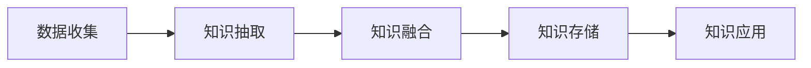
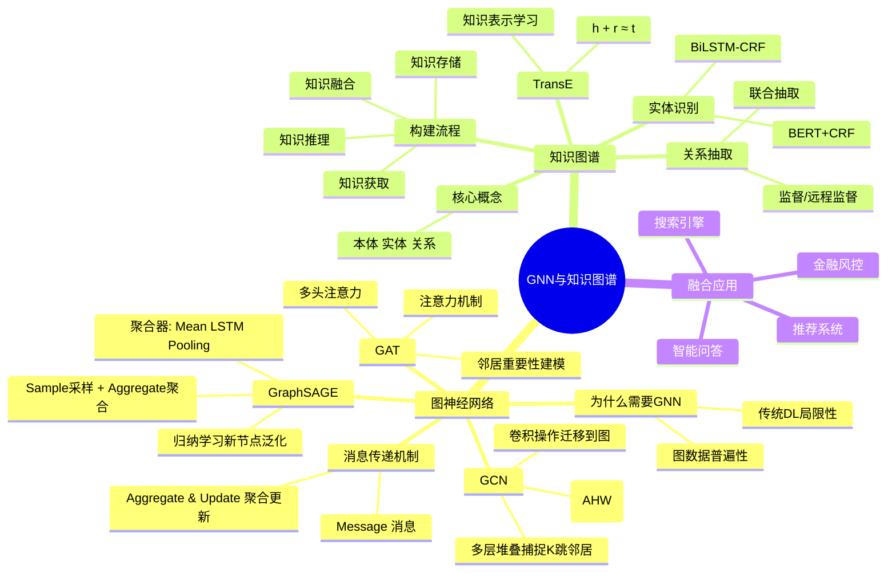

# 9-4 图神经网络与知识图谱

## 学习目标

- 理解为什么需要图神经网络（图数据的特殊性与挑战）
- 掌握三种经典GNN模型：GCN、GraphSAGE、GAT的原理与特点
- 理解图神经网络的核心操作：消息传递与聚合
- 了解知识图谱的基本概念与构建方法
- 掌握实体识别、关系抽取、TransE的核心原理

---

## 1. 为什么需要图神经网络

### 1.1 图数据的普遍性

现实世界中存在大量**非结构化、关系型数据**，这些数据天然适合用图来表示：

- **社交网络**：用户-好友关系、互动关系
- **知识图谱**：实体-关系-实体的三元组
- **推荐系统**：用户-商品-行为交互网络
- **生物信息**：分子结构、蛋白质相互作用网络
- **交通网络**：道路拓扑、流量数据

### 1.2 传统深度学习的局限性

传统的深度学习（CNN、RNN）主要处理**规则化数据**：
- 图像：固定尺寸的网格结构
- 文本：顺序序列结构

然而，图数据与生俱来具有以下**无序性**：
1. **大小任意**：图的节点数量不固定
2. **拓扑复杂**：没有固定的空间局部性
3. **无固定顺序**：节点没有参考顺序
4. **动态多模态**：经常是动态变化且包含多模态特征

### 1.3 图神经网络的出现

**图神经网络（Graph Neural Networks, GNN）** 将深度学习扩展到图结构数据上，能够：
- 学习节点的有效表示
- 捕捉图的结构信息
- 进行节点分类、链接预测、图分类等任务

---

## 2. 图神经网络基本原理

### 2.1 GNN 的基本形式

与传统神经网络（全连接层）相比，图神经网络多了一个**邻接矩阵**：

$$H^{(l+1)} = \sigma(A H^{(l)} W^{(l)} + b^{(l)})$$

其中：
- $A$：邻接矩阵
- $H^{(l)}$：第 $l$ 层的节点特征矩阵
- $W^{(l)}$：权重矩阵
- $\sigma$：激活函数

**核心思想**：每个节点的表示 = 其自身特征 + 邻居节点特征的聚合

### 2.2 消息传递机制

GNN 的核心是**消息传递（Message Passing）**范式，包含两步：

1. **消息传递（Message）**：计算从邻居节点传递的消息
2. **聚合更新（Aggregate & Update）**：聚合邻居消息并更新自身表示

$$h_v^{(k)} = \text{UPDATE}\left(h_v^{(k-1)}, \text{AGG}\left(\{h_u^{(k-1)} : u \in \mathcal{N}(v)\}\right)\right)$$

---

## 3. 三种经典GNN模型

### 3.1 GCN：图卷积网络

**GCN（Graph Convolutional Network）** 是图神经网络的"开山之作"，由Kipf和Welling在2017年提出。

#### 3.1.1 卷积操作

GCN 将图像卷积思想迁移到图结构上，对于第 $k$ 层：

$$H^{(k+1)} = \tilde{D}^{-1/2} \tilde{A} \tilde{D}^{-1/2} H^{(k)} W^{(k)}$$

其中：
- $\tilde{A} = A + I$（添加自连接的邻接矩阵）
- $\tilde{D}$：$\tilde{A}$ 的度矩阵
- $H^{(k)}$：第 $k$ 层输出

**简化理解**：节点的新的特征表示 = 邻居节点特征的均值 + 线性变换

#### 3.1.2 多层堆叠

堆叠 $K$ 层 GCN 可以捕捉 $K$ 跳（K-hop）邻居的信息：

$$H^{(K)} = f(A, H^{(0)}) = \tilde{D}^{-1/2} \tilde{A} \tilde{D}^{-1/2} \cdots \tilde{D}^{-1/2} \tilde{A} \tilde{D}^{-1/2} H^{(0)}$$

#### 3.1.3 GCN 的局限性

| 局限性 | 说明 |
|-------|------|
| **内存限制** | 需要将整个图加载到内存，无法处理大图 |
| **全图依赖** | 训练时需要知道整个图结构（包括测试节点） |
| **归纳能力弱** | 对新节点需要重新训练 |

---

### 3.2 GraphSAGE：采样聚合框架

**GraphSAGE（Graph Sample and Aggregate）** 由Stanford大学团队提出，专门解决GCN的两个痛点。

#### 3.2.1 核心思想：采样 + 聚合

GraphSAGE 是一个**归纳学习（Inductive Learning）**框架，包含两个核心步骤：

1. **Sample（采样）**：对邻居进行定长采样
2. **Aggregate（聚合）**：使用聚合函数聚合邻居信息

#### 3.2.2 聚合器类型

| 聚合器 | 说明 |
|-------|------|
| **Mean Aggregator** | 邻居特征的均值（与GCN类似） |
| **LSTM Aggregator** | 使用LSTM聚合序列信息 |
| **Pooling Aggregator** | 经过MLP后的最大池化 |

#### 3.2.3 GraphSAGE 的优点

- **采样机制**：克服内存限制，可处理大图
- **未知节点泛化**：能够为新节点生成embedding
- **参数共享**：聚合器和权重矩阵对所有节点共享
- **任务兼容**：支持有监督和无监督学习

#### 3.2.4 采样方法

GraphSAGE 采用**有放回的重采样**方法，保证每个节点的采样后邻居数固定（如固定采样 $K$ 个邻居），便于批量GPU训练。

---

### 3.3 GAT：图注意力网络

**GAT（Graph Attention Networks）** 借鉴Transformer的注意力机制，解决GraphSAGE中邻居重要性相同的问题。

#### 3.3.1 注意力机制

对于节点 $i$ 和邻居 $j$，计算注意力系数：

$$e_{ij} = \text{LeakyReLU}\left(\vec{a}^T [W \vec{h}_i || W \vec{h}_j]\right)$$

归一化注意力权重：

$$\alpha_{ij} = \text{softmax}_j(e_{ij}) = \frac{\exp(e_{ij})}{\sum_{k \in \mathcal{N}_i} \exp(e_{ik})}$$

#### 3.3.2 特征更新

$$h_i' = \sigma\left(\sum_{j \in \mathcal{N}_i} \alpha_{ij} W h_j\right)$$

#### 3.3.3 多头注意力

为提高模型表达能力，使用**多头注意力（Multi-Head Attention）**：

$$h_i'^{(m)} = \sigma\left(\sum_{j \in \mathcal{N}_i} \alpha_{ij}^{(m)} W^{(m)} h_j\right)$$

$$h_i' = \text{Concat}(h_i'^{(1)}, h_i'^{(2)}, \ldots, h_i'^{(M)}) \quad \text{或} \quad \text{Avg}(h_i'^{(m)})$$

#### 3.3.4 GAT 的优势

| 优势 | 说明 |
|-----|------|
| **重要性建模** | 自动学习不同邻居的重要性 |
| **并行计算** | 注意力计算可并行 |
| **归纳学习** | 无需预先构建图，适用于新节点 |

---

## 4. 知识图谱概述

### 4.1 基本概念

| 概念 | 说明 |
|-----|------|
| **本体（Ontology）** | 概念的集合，概念框架（如"人"、"事"、"物"） |
| **实体（Entity）** | 本体的实例 + 关系（如"小明"是"人"的实例） |
| **关系（Relation）** | 实体之间的语义联系 |
| **知识库（Knowledge Base）** | 多个实体形成的结构化数据库（如DBpedia） |
| **知识图谱（Knowledge Graph）** | 通过语义关联把实体关联起来的图谱组织形式 |

### 4.2 知识图谱的构建流程

**核心环节**：
1. **知识获取**：从文本、数据库等来源抽取实体和关系
2. **知识融合**：消除实体和关系的歧义，实现多源知识统一
3. **知识存储**：使用图数据库（如Neo4j）存储三元组
4. **知识推理**：基于已有知识推断新知识

---

## 5. 知识图谱的核心技术

### 5.1 实体识别

**实体识别（Entity Recognition）** 是从文本中识别出实体mention并将其分类到预定类型的过程。

**典型方法**：
- **BiLSTM-CRF**：利用双向LSTM提取序列特征，CRF层保证输出序列合法性
- **预训练模型 + 序列标注**：BERT + CRF/BiLSTM-CRF

**应用场景**：
- 医疗领域：识别疾病、症状、药物
- 金融领域：识别公司名、人名、产品名
- 通用领域：识别人名、地名、机构名

### 5.2 关系抽取

**关系抽取（Relation Extraction）** 是从文本中识别出实体之间关系的技术。

**经典方法**：
| 方法 | 说明 |
|-----|------|
| **监督学习** | 将关系分类转为分类问题，需要大量标注数据 |
| **远程监督** | 利用知识库自动生成训练数据 |
| **联合抽取** | 实体识别与关系抽取联合建模 |

**混合注意力原型网络**：在关系抽取中引入instance-level和feature-level的注意力机制，提升噪声数据下的分类性能。

### 5.3 TransE：知识表示学习

**TransE（Translating Embeddings）** 是最具影响力的知识表示学习方法之一。

#### 5.3.1 核心思想

对于三元组 $(h, r, t)$：
- $h$：头实体（head）
- $r$：关系（relation）
- $t$：尾实体（tail）

TransE 的核心假设是：**头实体 + 关系 ≈ 尾实体**

即：$\vec{h} + \vec{r} \approx \vec{t}$

#### 5.3.2 损失函数

$$\mathcal{L} = \sum_{(h,r,t) \in S} \sum_{(h',r,t') \in S'} [\gamma + d(\vec{h} + \vec{r}, \vec{t}) - d(\vec{h}' + \vec{r}, \vec{t}')]_+$$

其中：
- $S$：正确三元组集合
- $S'$：错误三元组集合（通过替换 $h$ 或 $t$ 生成）
- $d$：距离函数（如L1或L2范数）
- $\gamma$：margin超参数

#### 5.3.3 TransE 的局限性

| 局限 | 说明 |
|-----|------|
| **表达能力** | 难以处理一对多、多对一、多对多关系 |
| **动态关系** | 无法处理复杂的关系模式 |

**后续改进**：TransH、TransR、TransD 等模型通过引入关系超平面或动态投影矩阵来增强表达能力。

---

## 6. 知识图谱与深度学习的融合

### 6.1 融合方式

| 方式 | 说明 |
|-----|------|
| **用深度学习构建知识图谱** | 用CNN/BiLSTM进行实体识别、关系识别 |
| **用知识图谱辅助深度学习** | 知识图谱作为特征工程的管理工具 |
| **符号主义 + 联结主义融合** | 将知识图谱的符号表示为连续向量，供深度学习使用 |
| **知识作为约束** | 将知识图谱约束作为优化目标的后验正则项 |

### 6.2 应用场景

- **智能问答**：基于知识图谱的问答系统（如"姚明的身高是多少"）
- **推荐系统**：融合知识图谱增强推荐的可解释性
- **搜索引擎**：Google Knowledge Graph 提升搜索质量
- **金融风控**：企业关联分析、风险传导建模

---

## 7. 本章小结

图神经网络和知识图谱是当代AI处理结构化知识的重要技术：

**图神经网络**：
- **GCN** 开创性地将卷积操作迁移到图数据
- **GraphSAGE** 通过采样聚合解决了大图处理问题
- **GAT** 引入注意力机制建模邻居重要性

**知识图谱**：
- 本体-实体-关系的三层结构
- 实体识别和关系抽取是构建知识图谱的核心技术
- TransE及其改进提供了知识表示学习的理论基础

二者的融合代表了**符号主义**与**联结主义**的协同发展，为构建更强大的AI系统提供了重要支撑。

---

## 知识点思维导图

---

## 参考资料

1. Kipf, T. N., & Weller, M. (2017). Semi-Supervised Classification with Graph Convolutional Networks. *ICLR*.
2. Hamilton, W., et al. (2017). Inductive Representation Learning on Large Graphs. *NIPS*.
3. Veličković, P., et al. (2018). Graph Attention Networks. *ICLR*.
4. Zhou, J., et al. (2018). Graph Neural Networks: A Review of Methods and Applications. *arXiv*.
5. Bordes, A., et al. (2013). Translating Embeddings for Modeling Multi-relational Data. *NIPS*.
6. Wang, Q., et al. (2017). Knowledge Graph Embedding: A Survey of Approaches and Applications. *IEEE TKDE*.
7. 斯坦福大学. (2018). Hierarchical Graph Representation Learning with Differentiable Pooling. *NeurIPS*.
8. 阿里巴巴智能服务事业部. 小样本学习（Few-shot Learning）综述. 2019.
9. yyHaker. 终于有人总结了图神经网络！知乎专栏. 2020.
10. 三个角度理解知识图谱. 知乎专栏. 2019.