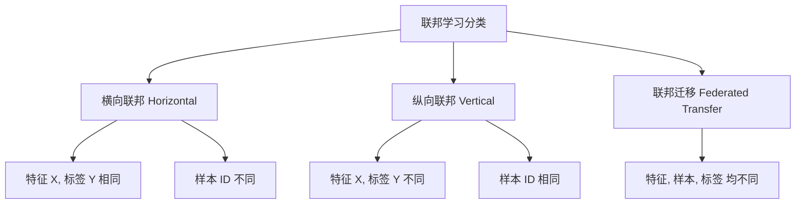
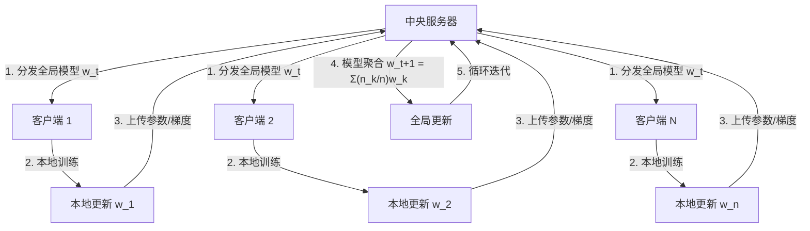
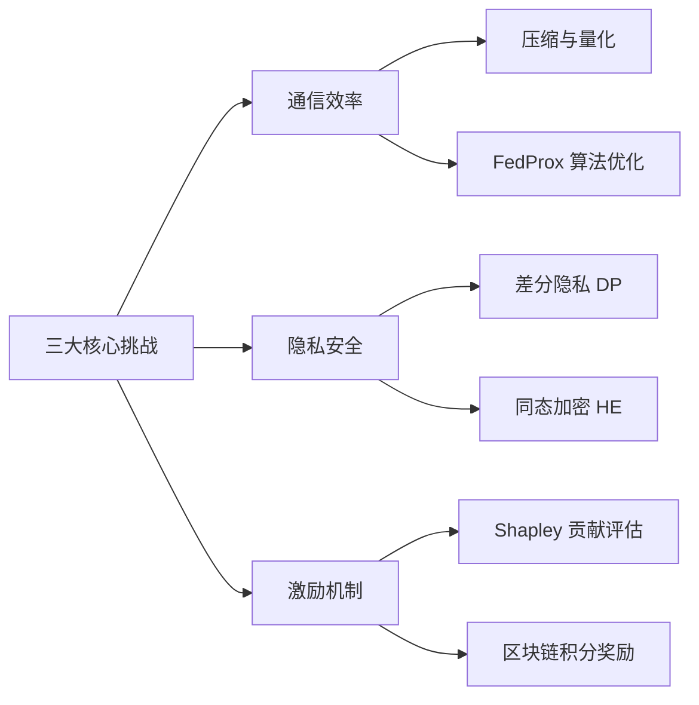
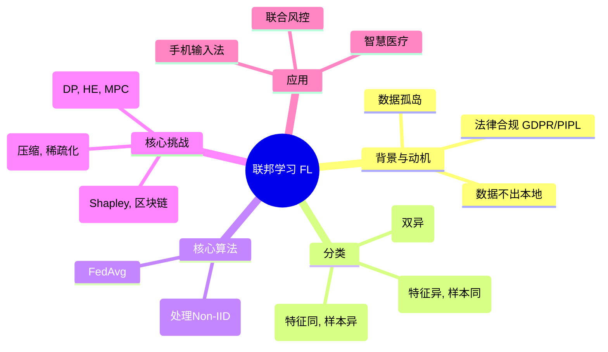

# 9-5 联邦学习与隐私保护

## 学习目标
- 理解联邦学习的背景：数据孤岛、隐私合规与传统分布式训练的局限
- 掌握联邦学习的核心思想：数据不动模型动、多方协同训练
- 掌握联邦学习的三大分类：横向联邦、纵向联邦、联邦迁移学习及其应用场景
- 理解 FedAvg 算法的标准流程及其对 Non-IID 数据的处理
- 了解联邦学习面临的三大核心挑战（通信、隐私、激励）及应对策略
- 了解联邦学习与分布式学习的本质区别

---

## 1. 联邦学习背景与动机

### 1.1 数据孤岛问题
在人工智能飞速发展的今天，高质量的数据是训练强大模型的基石。然而在现实中，数据往往以**数据孤岛（Data Silos）**的形式存在：
- **行业壁垒**：不同公司、不同机构之间的数据无法互通。
- **竞争关系**：商业对手由于利益冲突，不愿分享核心数据。
- **存储分散**：海量的用户数据分布在数亿台移动终端（如手机、IoT设备）上。

### 1.2 隐私合规挑战
随着隐私意识的觉醒，全球范围内出台了严格的数据保护法规：
- **GDPR（通用数据保护条例）**：欧盟出台，对个人隐私数据跨境和共享有极严限制。
- **《数据安全法》与《个人信息保护法》（PIPL）**：中国出台，明确了数据处理者的法律责任。
这些法规使得传统的“数据汇聚、集中训练”模式面临巨大的法律红线。

### 1.3 集中式训练的局限
传统的机器学习训练通常需要将各方数据上传至中央服务器：
1. **隐私泄露风险**：数据在传输和存储过程中易被窃取或滥用。
2. **通信开销巨大**：将PB级数据搬运至云端会消耗巨额带宽。
3. **法律合规性低**：违反“数据不出本地”的监管要求。

**联邦学习（Federated Learning, FL）**正是为了在不移动原始数据的前提下，实现多方协同训练模型而诞生的新范式。

---

## 2. 核心思想与定义

### 2.1 联邦学习定义
联邦学习是一种分布式机器学习框架，它允许各参与方在**不共享原始数据**的情况下，协同构建全局机器学习模型。

### 2.2 核心思想：数据不动，模型动
联邦学习改变了数据的流动方向：
- **传统模式**：数据 $\to$ 模型（数据汇聚到模型中心）。
- **联邦模式**：模型 $\to$ 数据（模型参数下发到数据所在地）。

### 2.3 联邦学习三要素
1. **数据不出本地**：原始数据始终留在客户端或机构内部。
2. **模型效果无损**：联邦模型的效果应尽可能接近集中式训练的效果。
3. **隐私安全保护**：通过加密、差分隐私等技术确保无法从交换的参数中反推出原始数据。

---

## 3. 联邦学习分类

根据数据在不同参与方之间的分布情况（样本维度和特征维度的重叠程度），联邦学习主要分为三类：

| 分类 | 适用场景 | 数据分布特征 | 核心技术 | 典型案例 |
| :--- | :--- | :--- | :--- | :--- |
| **横向联邦学习** (Horizontal FL) | 跨用户（2C） | 特征重叠大，样本重叠小。特征 X 和标签 Y 相同。 | 跨用户参数聚合、同态加密。 | 移动端输入法预测、手机健康监控。 |
| **纵向联邦学习** (Vertical FL) | 跨机构（2B） | 样本重叠大，特征重叠小。同一批用户，但领域特征不同。 | 实体对齐（PSI）、安全多方计算（MPC）。 | 银行（信用）+ 电商（消费）联合风控。 |
| **联邦迁移学习** (Federated Transfer) | 跨域跨组织 | 样本和特征重叠都很少。 | 迁移学习、跨域对齐。 | 只有少量病历的专科医院利用通用医疗模型。 |

### 3.1 联邦学习分类直观图示


---

## 4. FedAvg 算法流程

**FedAvg（Federated Averaging）**是横向联邦学习中最经典、最常用的基准算法。

### 4.1 算法流程图


### 4.2 算法伪代码 (PyTorch 风格)
```python
# FedAvg 核心逻辑模拟
def federated_averaging(clients, global_model, rounds):
    for r in range(rounds):
        local_weights = []
        # 1. 选择一部分客户端参与本轮训练
        selected_clients = random.sample(clients, K)
        
        for client in selected_clients:
            # 2. 客户端执行本地训练
            # 模型由服务器分发
            client.set_model(global_model.get_weights())
            client_weights = client.train_local_epochs(data=client.data)
            local_weights.append(client_weights)
            
        # 3. 服务器端聚合：加权平均
        new_global_weights = aggregate(local_weights, weights_by_sample_size)
        global_model.set_weights(new_global_weights)
        
    return global_model
```

---

## 5. 三大核心挑战与对策

联邦学习在实际落地中面临通信、安全和激励三个层面的严峻考验。

### 5.1 通信效率（Communication Efficiency）
- **问题**：客户端（如手机）带宽受限且不稳定，频繁传输大规模模型会导致延迟和功耗。
- **Non-IID 挑战**：各方数据分布不均匀（非独立同分布），导致模型收敛困难。
- **对策**：
  - **梯度压缩/量化**：减少每次传输的数据量。
  - **稀疏化更新**：只传输变化显著的部分参数。
  - **FedProx/Scaffold**：改进聚合算法，增强对非齐次数据的鲁棒性。

### 5.2 隐私安全（Privacy & Security）
- **问题**：虽然数据没动，但攻击者可能通过**模型反演攻击**或**成员推理攻击**从公开的模型梯度中反推出原始敏感数据。
- **对策**：
  - **差分隐私 (DP)**：在梯度中加入噪声，使单条数据无法被辨识。
  - **同态加密 (HE)**：服务器在密文状态下进行参数聚合，无法得知明文内容。
  - **安全多方计算 (MPC)**：多方协同计算，确保没有任何一方能获得完整中间值。

### 5.3 激励机制（Incentive Mechanism）
- **问题**：有些客户端可能为了节省资源而提供虚假梯度（搭便车行为），或者攻击者恶意破坏模型。
- **对策**：
  - **贡献评估**：基于沙普利值 (Shapley Value) 计算各参与方的贡献度。
  - **区块链结合**：使用智能合约记录贡献，发放代币作为奖励，确权数据价值。

### 5.4 挑战应对策略图


---

## 6. Non-IID 数据问题

在现实场景中，客户端数据往往是**非独立同分布 (Non-IID)** 的，这表现为：
- **特征分布倾斜**：不同地区的人拍出的图片光线、风格差异大。
- **标签分布倾斜**：有些人手机里全是风景图，有些人全是美食图。
- **样本量不平衡**：不同用户的活跃程度不同，数据量差异达数倍。

**改进方案**：
- **FedProx**：在本地损失函数中加入近端项（Proximal Term），限制本地模型偏离全局模型太远。
- **个性化联邦学习 (PFL)**：允许模型在保持全局一致性的同时，保留一定的本地特色。

---

## 7. 典型应用场景

1. **智慧医疗**：
   - 场景：多家医院联合训练癌症识别模型。
   - 价值：解决单一医院病例稀缺问题，同时严格遵守医疗隐私法规。
2. **金融风控**：
   - 场景：银行（有还款记录）与电商（有消费习惯）联合建立信用模型。
   - 价值：在不泄露客户名单的前提下实现纵向联邦联合建模。
3. **智慧城市/边缘计算**：
   - 场景：利用监控摄像头本地算力训练交通流量预测模型。
   - 价值：大幅降低实时监控视频传输到云端的成本。

---

## 8. 联邦学习 vs. 分布式训练

虽然两者都涉及多机计算，但在设计理念上有本质区别：

| 特性 | 分布式训练 (Distributed Learning) | 联邦学习 (Federated Learning) |
| :--- | :--- | :--- |
| **数据存储** | 中央集群划分，通常是 IID 分布。 | 分散在各客户端，强烈的 Non-IID 属性。 |
| **隐私保护** | 假定各节点是可信的或在同一局域网。 | 节点不可信，必须有隐私增强技术支撑。 |
| **通信内容** | 频繁同步权重、梯度。 | 较低频率同步模型更新。 |
| **拓扑结构** | 相对稳定（机房、超算）。 | 极不稳定（手机随时上线离线）。 |

---

## 9. 知识点思维导图



---

## 参考资料
1. McMahan, B., et al. (2017). Communication-Efficient Learning of Deep Networks from Decentralized Data. *AISTATS*. (FedAvg 开山之作)
2. Yang, Q., et al. (2019). Federated Machine Learning: Concept and Applications. *TIST*. (联邦学习综述)
3. Li, T., et al. (2020). Federated Optimization in Heterogeneous Networks. *MLSys*. (FedProx 算法)
4. 微众银行 AI 团队. 《联邦学习》. 电子工业出版社. 
5. 参见 [第 10-2 章 混合精度与分布式训练](../PART10-训练优化与部署/10-2-混合精度与分布式训练.md) 了解基础分布式计算背景。
6. 参见 [第 14-2 章 AI 安全与对抗](../PART14-AI伦理与安全/14-2-AI安全与对抗.md) 了解差分隐私更多技术细节。
