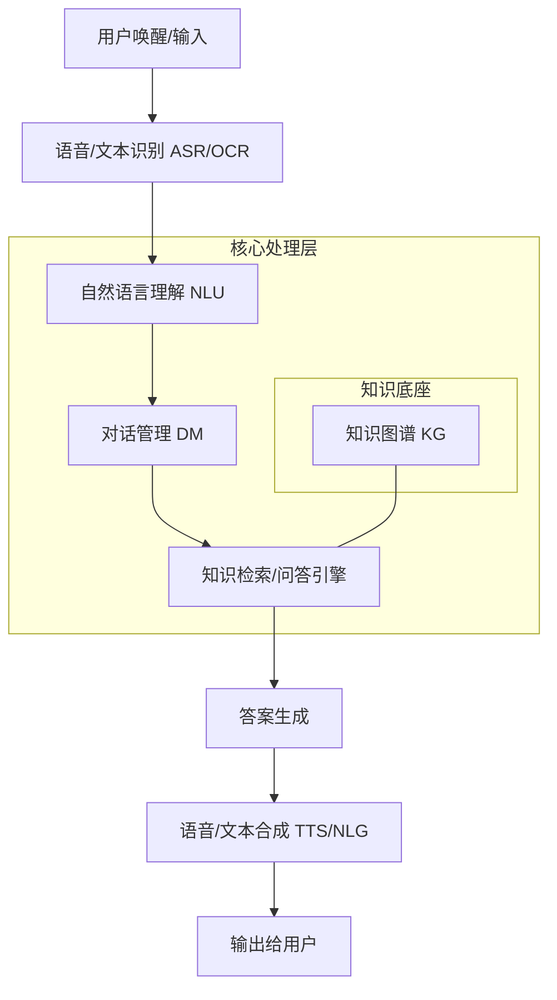
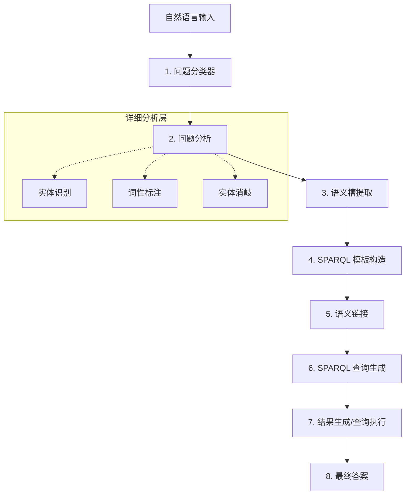
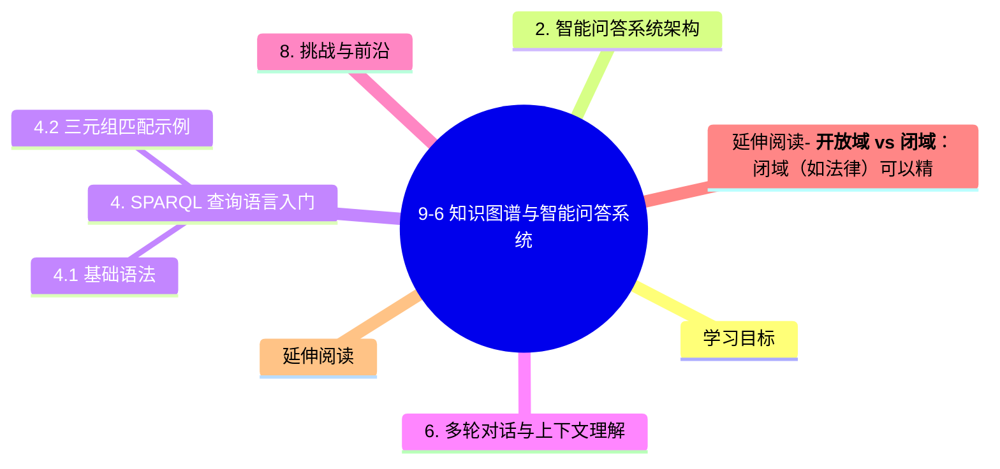

# 9-6 知识图谱与智能问答系统

> **补充阅读**：本章节旨在探讨知识图谱在实际工业场景中的核心落地应用——智能问答系统（Question Answering, QA）。本章内容建立在 [9-4 章节（图神经网络与知识图谱）](./9-4-图神经网络与知识图谱.md) 的基础之上。

## 学习目标
- 理解知识图谱问答系统（KGQA）的演进路径与核心优势。
- 掌握智能问答系统的标准工业架构及核心组件。
- 熟悉知识图谱问答匹配的 8 个核心步骤。
- 掌握 SPARQL 查询语言的基础语法。
- 了解多轮对话、上下文理解及智能问答的挑战。

---

## 1. 知识图谱问答系统概述

### 1.1 从搜索到问答的演进
随着 AI 技术的进步，用户与信息的交互方式正在发生深刻变革：
1. **搜索 (Search)**：基于关键词匹配，返回网页列表。
2. **问答 (QA)**：直接理解用户意图，返回精准答案。
3. **推荐 (Recommendation)**：根据兴趣偏好主动推送。
4. **决策 (Decision)**：基于知识逻辑提供建议与行动方案。

### 1.2 问答系统的三种类型
| 类型 | 目标 | 核心技术 | 场景示例 |
| :--- | :--- | :--- | :--- |
| **面向任务 (Task-oriented)** | 完成特定操作 | 对话管理 (DM)、插槽填充 | 定机票、设定闹钟 |
| **面向知识 (KBQA/KGQA)** | 获取客观事实 | 实体链接、路径搜索 | “姚明的妻子是谁？” |
| **面向聊天 (Chitchat)** | 情感陪伴/闲聊 | 生成式模型 (Seq2Seq) | 微软小冰、日常闲谈 |

### 1.3 核心优势
相比于单纯的检索式问答或纯语言模型（LLM）生成的问答，基于知识图谱的问答系统具有以下优势：
- **支持上下文推理**：通过图谱中的路径跳转实现跨实体推理。
- **支持多跳问答 (Multi-hop)**：例如“出演过《盗梦空间》的演员中谁获得过奥斯卡？”。
- **可解释性强**：答案基于明确的三元组路径，推理逻辑可追溯。

---

## 2. 智能问答系统架构

智能问答系统的标准工业架构是一个多模块协同的闭环系统，如下图所示：



**核心模块说明**：
- **NLU (自然语言理解)**：意图识别、命名实体识别（NER）。
- **知识图谱 (KG)**：提供实体、属性及关系构成的结构化事实库。
- **对话管理 (DM)**：控制对话流转，维护状态。
- **深度问答**：综合语义匹配与图谱推理生成答案。

---

## 3. 知识图谱问答匹配流程

KGQA 的匹配流程通常包含以下 8 个关键步骤：



1.  **自然语言输入**：接收原始语音或文本。
2.  **问题分类器**：判断是事实型、列表型还是布尔型问题。
3.  **问题分析**：包括分词、词性标注、命名实体识别及实体消岐（判定“苹果”是水果还是公司）。
4.  **语义槽提取**：确定用户想查的实体和属性（Slot Filling）。
5.  **SPARQL 模板构造**：根据意图匹配预定义的查询模板。
6.  **语义链接**：将识别出的实体映射到 KG 中的唯一 URL/ID。
7.  **SPARQL 查询生成**：填充变量，生成可执行的查询语句。
8.  **结果生成**：解析查询结果并转换为用户可读的自然语言。

### 3.1 工业级问答流水线

在工业场景里，KGQA 往往不是“直接把问题翻成 SPARQL”这么简单，而是更像一条稳定的问答流水线：

**问句预处理 → 候选检索 → 深度语义匹配/重排 → 图谱查询/答案生成**。

其中，问句预处理会优先处理分词、词性标注、纠错、问句改写、多意图识别等问题；这样做的目的不是扩展成通用 NLP 课，而是为了提升后续实体链接和关系匹配的稳定性。对于长问题、口语化追问或实体不明确的情况，系统通常还需要做候选澄清，再进入图谱查询与答案归并。

---

## 4. SPARQL 查询语言入门

知识图谱主要使用 **SPARQL** (SPARQL Protocol and RDF Query Language) 进行数据检索。

### 4.1 基础语法
SPARQL 语法类似于 SQL，主要由 `SELECT` 和 `WHERE` 子句组成：
- `SELECT`：指定要返回的变量（以 `?` 开头）。
- `WHERE`：定义三元组匹配模式。

### 4.2 三元组匹配示例
假设我们要查询“姚明的出生地”：

```sparql
PREFIX kg: <http://example.org/ontology/>
PREFIX person: <http://example.org/resource/>

SELECT ?birthplace
WHERE {
  person:Yao_Ming kg:hasBirthplace ?birthplace .
}
```

**理解要点**：
- `person:Yao_Ming` 是**主语 (Subject)**。
- `kg:hasBirthplace` 是**谓语 (Predicate)**。
- `?birthplace` 是我们要找的**宾语变量 (Object)**。

---

## 5. 典型知识图谱问答产品对比

| 产品名称 | 核心特征 | 应用领域 |
| :--- | :--- | :--- |
| **IBM Watson** | 经典的 Deep QA 流程，支持假设生成与多维证据融合。 | 医疗诊断、金融法律 |
| **百度度秘 (DuerOS)** | 集成百度百科图谱，支持语音交互，强调多模态感知。 | 智能家居、智能助手 |
| **阿里小蜜** | 结合知识图谱与强化学习，擅长多轮对话与复杂垂直领域。 | 电商客服、政务服务 |
| **搜狗汪仔** | 基于“立知”系统，在百科类事实问答和搜索增强上表现突出。 | 搜索引擎、智能穿戴 |

---

## 6. 多轮对话与上下文理解

在真实的问答场景中，用户往往不会一次性提供所有信息，需要系统具备处理上下文的能力。

1.  **上下文 (Context) 管理**：维护对话历史，存储已识别的实体和意图。
2.  **指代消解 (Coreference Resolution)**：理解用户口中的代词。例如：
    - 用户 A：“周杰伦的老婆是谁？”（系统返回：昆凌）
    - 用户 B：“**她**多大了？”（系统需要识别“她”指代“昆凌”）
3.  **对话状态跟踪 (DST)**：在对话的每一轮实时更新语义槽的状态。参见 [7-3（Prompt Engineering）](../PART7-大语言模型LLM/7-3-Prompt-Engineering.md) 关于多轮引导的策略。

---

## 7. 知识图谱构建流程回顾

要构建一个高质量的问答系统，底层知识图谱的质量至关重要：
- **实体维度挖掘**：从非结构化文本中提取专有名词。
- **短句维度挖掘**：提取描述实体的核心短句。
- **主题模型与关系定义**：明确实体间的逻辑关联。
- **算法支持**：使用 TransE 或 GNN 进行关系表示学习与知识补全（参见 [9-4 章节](./9-4-图神经网络与知识图谱.md)）。

---

## 8. 挑战与前沿

虽然 KGQA 已经取得了显著成果，但仍面临诸多挑战：
- **知识覆盖率 (Recall)**：长尾知识往往在图谱中缺失。
- **数据质量 (Precision)**：噪声数据会导致推理错误。
- **多模态知识**：图像、表格、视频等非结构化数据的知识表示与检索。
- **推理可解释性**：黑盒模型的推理路径难以追溯。
- **跨语言知识图谱**：多语言实体对齐与查询翻译。

---

## 本章小结

1. **知识图谱定义**：以结构化的"实体-关系-实体"三元组表示真实世界的语义网络。
2. **KGQA 三步走**：问题理解（实体识别 + 意图分类）→ 查询构建（SPARQL / 模板）→ 结果返回与排序。
3. **查询类型**：事实型（单跳）、多跳型（推理）、聚合型（统计）、开放型（模糊匹配）。
4. **多轮对话**：需维护上下文、解决指代消解、跟踪对话状态。
5. **挑战与前沿**：长尾覆盖、噪声过滤、神经符号融合、跨语言 KG。
6. **典型产品对比**：DBpedia（百科）、Wikidata（协作）、YAGO（多源）、CN-DBpedia（中文）、Neo4j（图数据库）、Amazon Neptune（云端）。

---

## 延伸阅读- **开放域 vs 闭域**：闭域（如法律）可以精细设计模板，而开放域对鲁棒性要求极高。
- **神经符号推理 (Neural-Symbolic)**：尝试将神经网络的感知能力与逻辑符号的推理能力结合，实现端到端、可微分的知识图谱问答系统。

---

## 延伸阅读
- [知识图谱简史：从 Cyc 到 Google Knowledge Graph]
- [神经符号 AI 的崛起：赋予深度学习逻辑思考能力]

---
**上一章**：[9-5 联邦学习与隐私保护](./9-5-联邦学习与隐私保护.md)
**下一章**：[9-7 智能问答系统完整 Pipeline](./9-7-智能问答系统完整Pipeline.md)

## 知识图谱


