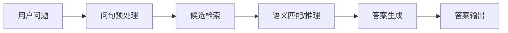
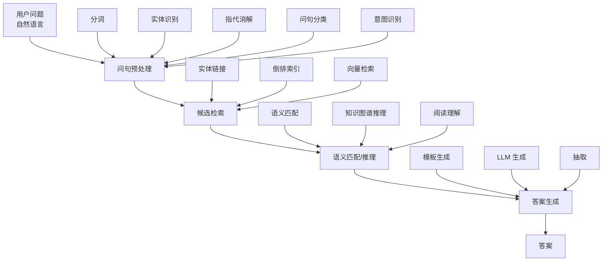
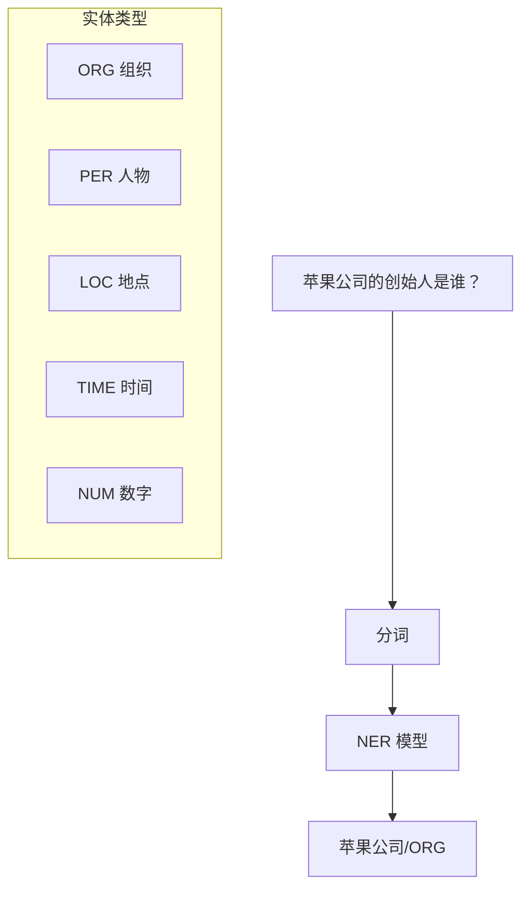
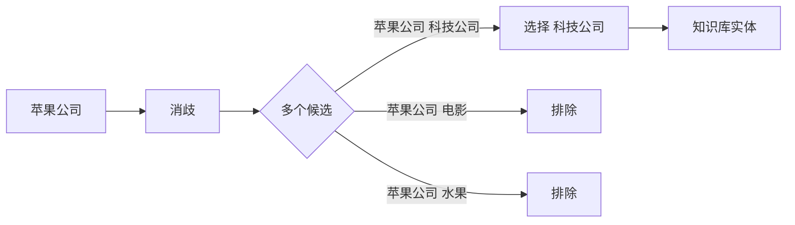
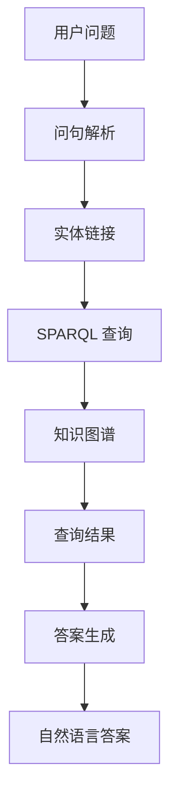
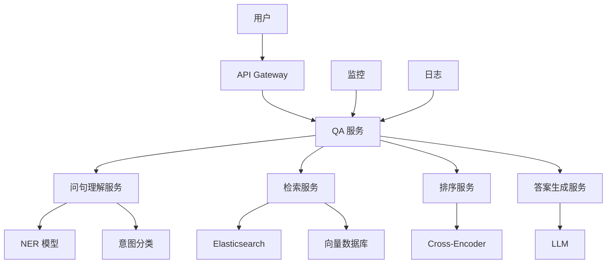
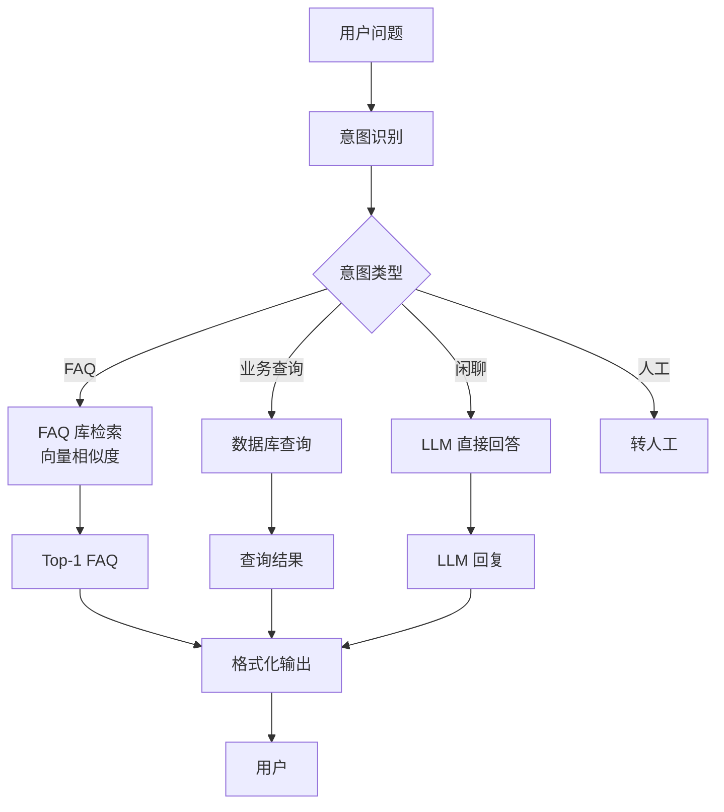
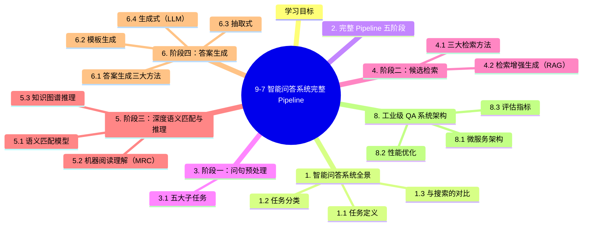

# 9-7 智能问答系统完整 Pipeline

## 学习目标

- 理解智能问答（QA）系统的完整技术栈
- 掌握问句预处理的五大步骤
- 熟悉候选检索的三大方法（实体链接、倒排索引、向量检索）
- 理解深度语义匹配与答案生成的现代方法
- 能够搭建端到端的智能问答 Pipeline
- 了解基于知识图谱的问答（KGQA）实战

---

## 1. 智能问答系统全景

### 1.1 任务定义

**智能问答（Question Answering, QA）**：给定用户用自然语言提出的问题，系统自动给出准确答案。



### 1.2 任务分类

### 1.3 与搜索的对比

| 维度 | 搜索引擎 | 智能问答 |
|------|---------|---------|
| **输入** | 关键词 | 自然语言问题 |
| **输出** | 相关文档列表 | 直接答案 |
| **交互** | 用户自己找答案 | 系统直接给答案 |
| **核心技术** | 倒排索引 + 排序 | 检索 + 理解 + 生成 |

---

## 2. 完整 Pipeline 五阶段



---

## 3. 阶段一：问句预处理

### 3.1 五大子任务

#### 3.1.1 分词（Tokenization）

```python
import jieba

# 中文分词
question = "苹果公司的创始人是谁？"
tokens = jieba.lcut(question)
# ['苹果', '公司', '的', '创始人', '是', '谁', '？']

# 英文 tokenization
import re
def simple_en_tokenize(text):
    return re.findall(r'\w+', text.lower())
```

#### 3.1.2 实体识别（NER）

识别问题中的命名实体：



```python
from transformers import AutoTokenizer, AutoModelForTokenClassification, pipeline

# 使用预训练 NER 模型
model_name = "bert-base-chinese-ner"
tokenizer = AutoTokenizer.from_pretrained(model_name)
model = AutoModelForTokenClassification.from_pretrained(model_name)
ner = pipeline("ner", model=model, tokenizer=tokenizer)

entities = ner("苹果公司的创始人是谁？")
# [{'entity': 'ORG', 'word': '苹果公司', ...}]
```

#### 3.1.3 指代消解（Coreference Resolution）

把代词替换为上文提到的实体：

```python
# 输入
conversation = [
    "乔布斯创立了苹果公司。",
    "他出生于1955年。"  # "他" 指的是乔布斯
]

# 输出
resolved = [
    "乔布斯创立了苹果公司。",
    "乔布斯出生于1955年。"
]
```

**工具**：Hugging Face `coref` 模型、AllenNLP coref

#### 3.1.4 问句分类

识别问题类型，决定答案形式：

| 类别 | 关键词 | 答案形式 |
|------|--------|----------|
| **人物** | 谁、人物、出生 | 人物实体 |
| **地点** | 在哪、位于、城市 | 地点实体 |
| **时间** | 何时、日期 | 时间点 |
| **数字** | 多少、几个、几岁 | 数字 |
| **原因** | 为什么、原因 | 文本 |
| **方法** | 如何、怎么 | 文本 |
| **定义** | 是什么、含义 | 文本 |
| **是/否** | 是不是、是否 | 布尔 |

```python
import re

def classify_question(question):
    if re.search(r'(谁|哪位|人物)', question):
        return 'PERSON'
    if re.search(r'(在哪|哪里|地点|城市)', question):
        return 'LOCATION'
    if re.search(r'(何时|什么时候|日期|年份)', question):
        return 'TIME'
    if re.search(r'(多少|几|多少个)', question):
        return 'NUMBER'
    if re.search(r'(为什么|原因|为何)', question):
        return 'REASON'
    if re.search(r'(怎么|如何|怎样)', question):
        return 'METHOD'
    if re.search(r'(是什么|什么是|含义)', question):
        return 'DEFINITION'
    if re.search(r'(是不是|是否|有没有)', question):
        return 'BOOLEAN'
    return 'OTHER'
```

#### 3.1.5 意图识别

在客服/对话系统中，识别用户意图（预定、查询、投诉、闲聊）：

```python
INTENTS = {
    '查天气': 'weather_query',
    '查路线': 'navigation_query',
    '订外卖': 'food_order',
    '退款': 'refund',
    '闲聊': 'chitchat',
}
```

**实现**：文本分类模型，详见 7-3 Prompt Engineering 与 9-4 图神经网络。

---

## 4. 阶段二：候选检索

### 4.1 三大检索方法

#### 4.1.1 实体链接（Entity Linking）

把问题中的实体链接到知识库中的对应条目：



**实现**：

```python
# 基于向量相似度
def entity_linking(text, kb_entities, embedding_model):
    text_emb = embedding_model.encode(text)
    scores = [cosine_similarity(text_emb, embedding_model.encode(e)) 
              for e in kb_entities]
    return kb_entities[scores.index(max(scores))]
```

#### 4.1.2 倒排索引（Inverted Index）

经典搜索方法，建立"词 → 文档"映射：

```python
# 简化版倒排索引
from collections import defaultdict

inverted_index = defaultdict(list)
# 假设 docs 是文档集合
for doc_id, doc in enumerate(docs):
    for term in set(tokenize(doc)):
        inverted_index[term].append(doc_id)

# 查询
def search(query, top_k=10):
    q_terms = tokenize(query)
    scores = defaultdict(int)
    for term in q_terms:
        for doc_id in inverted_index.get(term, []):
            scores[doc_id] += 1
    return sorted(scores.items(), key=lambda x: -x[1])[:top_k]
```

**BM25** 是更精细的排序算法：

$$
\text{BM25}(q, d) = \sum_{t \in q} \text{IDF}(t) \cdot \frac{f(t, d) \cdot (k_1 + 1)}{f(t, d) + k_1 \cdot (1 - b + b \cdot \frac{|d|}{avgdl})}
$$

**工具**：Elasticsearch、Whoosh、Lucene

#### 4.1.3 向量检索（Dense Retrieval）

把文本编码为向量，用**向量相似度**检索：

```python
import numpy as np

# 1. 离线：编码所有文档
doc_embeddings = model.encode(documents)  # shape: (N, D)

# 2. 在线：编码查询
query_emb = model.encode(query)  # shape: (D,)

# 3. 相似度计算
scores = np.dot(doc_embeddings, query_emb) / (
    np.linalg.norm(doc_embeddings, axis=1) * np.linalg.norm(query_emb)
)
top_k_idx = np.argsort(scores)[-10:][::-1]
```

**优势**：
- 语义匹配（不是字面匹配）
- 跨语言检索
- 容错性强

**工具**：
- **FAISS**：Meta 开源向量检索库
- **Milvus**：分布式向量数据库
- **Chroma**：轻量级向量数据库
- **Qdrant**：生产级向量数据库

**混合检索**：先 BM25 召回 Top-1000，再向量精排 Top-10，效果最好。

### 4.2 检索增强生成（RAG）

详见 7-4 LLM 进阶技术 中的 RAG 章节。核心思想：检索到的文档作为 LLM 的上下文。

---

## 5. 阶段三：深度语义匹配与推理

### 5.1 语义匹配模型

#### 5.1.1 基于 BERT 的双塔模型

```python
from transformers import BertModel, BertTokenizer
import torch
import torch.nn.functional as F

class DualEncoderQA(torch.nn.Module):
    def __init__(self, model_name='bert-base-chinese'):
        super().__init__()
        self.bert = BertModel.from_pretrained(model_name)
    
    def encode(self, text, tokenizer):
        inputs = tokenizer(text, return_tensors='pt', padding=True, truncation=True)
        with torch.no_grad():
            outputs = self.bert(**inputs)
        return outputs.last_hidden_state[:, 0, :]  # [CLS] 向量
    
    def forward(self, q_emb, a_emb):
        # 相似度 = 点积 / cos
        return F.cosine_similarity(q_emb, a_emb)

# 使用
question_emb = model.encode("什么是机器学习？", tokenizer)
answer_emb = model.encode("机器学习是人工智能的一个分支...", tokenizer)
score = model(question_emb, answer_emb)
```

#### 5.1.2 Cross-Encoder（更精确）

```python
class CrossEncoderQA(torch.nn.Module):
    def __init__(self, model_name='bert-base-chinese'):
        super().__init__()
        self.bert = BertModel.from_pretrained(model_name)
        self.classifier = torch.nn.Linear(768, 1)
    
    def forward(self, question, answer, tokenizer):
        # 拼接 [CLS] Q [SEP] A [SEP]
        text = question + ' [SEP] ' + answer
        inputs = tokenizer(text, return_tensors='pt')
        outputs = self.bert(**inputs)
        cls = outputs.last_hidden_state[:, 0, :]
        return torch.sigmoid(self.classifier(cls))
```

**对比**：

| 维度 | Dual-Encoder | Cross-Encoder |
|------|--------------|----------------|
| **速度** | 快（可预计算） | 慢（必须重算） |
| **精度** | 中 | 高 |
| **适用** | 召回（粗排） | 精排 |

### 5.2 机器阅读理解（MRC）

直接从文档中抽取答案：

```python
# 训练数据格式
{
    "context": "乔布斯于1955年2月24日出生于美国旧金山。",
    "question": "乔布斯出生于哪一年？",
    "answer": {"text": "1955年", "start": 5, "end": 10}
}
```

**代表模型**：
- **BERT** (2018)：SQuAD 1.1 突破
- **ALBERT** (2019)：轻量化 BERT
- **RoBERTa** (2019)：更强训练
- **ERNIE** (Baidu 2019)：中文增强
- **MacBERT** (CMU 2020)：中文 MLM 改进
- **ELECTRA** (2020)：替换检测预训练
- **DeBERTa** (2020)：解耦注意力

**SQuAD 排行榜**：

| 模型 | EM | F1 |
|------|-----|-----|
| BERT-base | 80.8 | 88.5 |
| BERT-large | 84.1 | 91.1 |
| RoBERTa-large | 88.5 | 94.6 |
| ALBERT-xxl | 89.3 | 95.6 |
| DeBERTa-v3-large | **91.5** | **96.4** |
| GPT-4 | 86.8 | 91.2 |

### 5.3 知识图谱推理

详见 9-4/9-6 章节。核心：用图谱多跳推理回答复杂问题。

```sparql
# SPARQL 查询示例
SELECT ?founder ?birthDate WHERE {
  ?company rdfs:label "苹果公司"@zh .
  ?company dbo:founder ?founder .
  ?founder dbo:birthDate ?birthDate .
}
```

---

## 6. 阶段四：答案生成

### 6.1 答案生成三大方法

### 6.2 模板生成

```python
TEMPLATES = {
    'PERSON': "根据资料，{entity}的{founder}是{answer}。",
    'LOCATION': "根据资料，{entity}位于{answer}。",
    'TIME': "根据资料，{entity}的时间是{answer}。",
}

def template_answer(question_type, entities, answer):
    template = TEMPLATES.get(question_type, "根据资料，答案是{answer}。")
    return template.format(entity=entities[0] if entities else '该对象',
                          founder='创始人' if '创始人' in question_type else '',
                          answer=answer)
```

### 6.3 抽取式

直接定位答案在原文中的位置：

```python
def extract_answer(context, question, start, end):
    return context[start:end]
```

### 6.4 生成式（LLM）

最现代的方法，用 LLM 综合所有信息生成答案：

```python
import ollama

def generate_answer(question, context):
    prompt = f"""基于以下参考资料回答用户问题。如果资料不包含答案，请说"我不知道"。

参考资料：
{context}

用户问题：{question}
回答："""
    
    response = ollama.chat(
        model='qwen2.5:7b',
        messages=[{'role': 'user', 'content': prompt}]
    )
    return response['message']['content']
```

**优势**：
- 答案流畅自然
- 可处理多文档综合
- 可处理多跳问题

**挑战**：
- 幻觉（Hallucination）
- 长上下文超出窗口
- 推理不可控

---

## 7. 阶段五：知识图谱问答（KGQA）实战

### 7.1 KGQA 架构



### 7.2 完整代码示例

```python
import ollama
from rdflib import Graph

# 1. 加载知识图谱
kg = Graph()
kg.parse('knowledge_graph.ttl', format='turtle')

# 2. 实体库
ENTITIES = {
    '苹果公司': 'http://example.org/entity/Apple_Inc',
    '乔布斯': 'http://example.org/entity/Steve_Jobs',
    '比尔·盖茨': 'http://example.org/entity/Bill_Gates',
    '微软': 'http://example.org/entity/Microsoft',
}

# 3. SPARQL 查询模板
SPARQL_TEMPLATES = {
    'founder': """
        PREFIX dbo: <http://dbpedia.org/ontology/>
        PREFIX rdfs: <http://www.w3.org/2000/01/rdf-schema#>
        SELECT ?founder WHERE {{
            <{entity}> dbo:founder ?founder .
        }}
    """,
    'birthdate': """
        PREFIX dbo: <http://dbpedia.org/ontology/>
        SELECT ?date WHERE {{
            <{entity}> dbo:birthDate ?date .
        }}
    """,
}

# 4. 实体链接（简化版）
def link_entity(text, entities_dict):
    text_lower = text.lower()
    for name, uri in entities_dict.items():
        if name in text:
            return name, uri
    return None, None

# 5. 意图识别
def detect_intent(question):
    q = question
    if '创始人' in q or '创立' in q:
        return 'founder'
    if '出生' in q or '生日' in q:
        return 'birthdate'
    if '总部' in q or '位置' in q:
        return 'location'
    return None

# 6. SPARQL 查询
def query_kg(entity_uri, intent):
    if intent not in SPARQL_TEMPLATES:
        return None
    sparql = SPARQL_TEMPLATES[intent].format(entity=entity_uri)
    results = kg.query(sparql)
    return [str(r[0]) for r in results]

# 7. 自然语言生成
def generate_nl_answer(question, intent, entities, results):
    if not results:
        return "抱歉，知识图谱中没有相关信息。"
    
    prompt = f"""请基于以下信息回答用户问题。
    
问题：{question}
实体：{', '.join(entities)}
查询结果：{', '.join(results)}

请用流畅自然的中文回答。"""
    
    response = ollama.chat(
        model='qwen2.5:7b',
        messages=[{'role': 'user', 'content': prompt}]
    )
    return response['message']['content']

# 8. 完整 Pipeline
def kg_qa(question):
    # 步骤 1: 实体链接
    entity_name, entity_uri = link_entity(question, ENTITIES)
    if not entity_uri:
        return "抱歉，我无法识别问题中的实体。"
    
    # 步骤 2: 意图识别
    intent = detect_intent(question)
    if not intent:
        return "抱歉，我无法理解问题意图。"
    
    # 步骤 3: SPARQL 查询
    results = query_kg(entity_uri, intent)
    
    # 步骤 4: 自然语言生成
    return generate_nl_answer(question, intent, [entity_name], results)

# 9. 测试
print(kg_qa("苹果公司的创始人是谁？"))
print(kg_qa("乔布斯的出生日期？"))
```

### 7.3 高级：多跳推理

```sparql
# "乔布斯创立的公司的总部在哪里？" (2 跳)
SELECT ?location WHERE {
  ?person rdfs:label "乔布斯"@zh .
  ?person dbo:founder ?company .
  ?company dbo:location ?location .
}
```

```python
def multi_hop_qa(question):
    """简单多跳：每跳一个 SPARQL"""
    # 步骤 1: 找人物
    person = extract_entity(question, type='PERSON')
    # 步骤 2: 找创立的公司
    companies = query_kg(person, 'founded_companies')
    # 步骤 3: 找公司总部
    for company in companies:
        location = query_kg(company, 'location')
        if location:
            return f"{person}创立的{company[0]}总部在{location[0]}。"
    return "信息不足。"
```

---

## 8. 工业级 QA 系统架构

### 8.1 微服务架构



### 8.2 性能优化

| 优化项 | 方法 | 收益 |
|--------|------|------|
| **检索加速** | FAISS GPU / 预计算 embedding | 10-100x |
| **缓存** | Redis 缓存常见问题 | 90%+ 命中 |
| **批量推理** | 多请求 batching | 5-10x 吞吐 |
| **异步处理** | 复杂问题后台处理 | 提升 QPS |
| **预加载模型** | 模型常驻内存 | 减少冷启动 |

### 8.3 评估指标

| 指标 | 计算 | 含义 |
|------|------|------|
| **EM (Exact Match)** | 答案完全匹配 | 严格度 |
| **F1** | token 级 F1 | 部分匹配 |
| **BLEU** | n-gram 精度 | 生成质量 |
| **ROUGE** | n-gram 召回 | 内容覆盖 |
| **人工评估** | 准确率、流畅度 | 真实质量 |
| **业务指标** | 解决率、满意度 | 用户角度 |

---

## 9. 多轮对话管理

### 9.1 上下文追踪

```python
class DialogueManager:
    def __init__(self):
        self.history = []  # [(role, content), ...]
        self.context = {}  # 实体、状态等
    
    def add_user_message(self, message):
        self.history.append(('user', message))
        # 抽取上下文实体
        entities = self.extract_entities(message)
        self.context.update(entities)
    
    def add_system_message(self, message):
        self.history.append(('system', message))
    
    def get_response(self, new_question):
        # 1. 指代消解（把"他"换成具体人名）
        resolved = self.coreference_resolve(new_question)
        
        # 2. 查询
        answer = self.qa(resolved, context=self.context)
        
        # 3. 更新历史
        self.add_user_message(new_question)
        self.add_system_message(answer)
        
        return answer

# 测试
dm = DialogueManager()
print(dm.get_response("苹果公司的创始人是谁？"))
# → "乔布斯"
print(dm.get_response("他创立了哪一年？"))
# → 指代消解后变成 "乔布斯创立了哪一年？"
# → "1976 年"
```

### 9.2 槽位填充

```python
SLOTS = {
    '目的地': None,
    '出发时间': None,
    '出行方式': None,
}

def slot_filling(current_state, user_input):
    if '明天' in user_input or '今天' in user_input:
        current_state['出发时间'] = extract_time(user_input)
    if '飞机' in user_input or '火车' in user_input:
        current_state['出行方式'] = extract_method(user_input)
    if '北京' in user_input or '上海' in user_input:
        current_state['目的地'] = extract_location(user_input)
    return current_state

# 多轮直到所有槽位填齐
def multi_turn_qa():
    state = SLOTS.copy()
    while None in state.values():
        user = input("用户: ")
        state = slot_filling(state, user)
        if None in state.values():
            missing = [k for k, v in state.items() if v is None][0]
            print(f"系统: 请问{info[missing]}？")
        else:
            # 槽位完整，执行查询
            result = query(state)
            print(f"系统: {result}")
            break
```

---

## 10. 实战：端到端 FAQ 客服系统

### 10.1 系统架构



### 10.2 代码

```python
import ollama
import chromadb

# 1. 准备 FAQ 库
faqs = [
    {"q": "如何退款？", "a": "您可以在订单页面点击申请退款，我们会在 3 个工作日内处理。"},
    {"q": "配送时间多久？", "a": "通常下单后 24 小时内发货，2-3 天到达。"},
    {"q": "如何联系客服？", "a": "您可以拨打 400-123-4567，或在 App 内提交工单。"},
    {"q": "支持哪些支付方式？", "a": "支持微信、支付宝、银联卡。"},
]

# 2. 用 Ollama 嵌入
client = chromadb.PersistentClient(path="./faq_db")
collection = client.get_or_create_collection("faqs")
for i, faq in enumerate(faqs):
    emb = ollama.embeddings(model='nomic-embed-text', prompt=faq['q'])['embedding']
    collection.add(ids=[str(i)], embeddings=[emb], 
                   documents=[faq['q']], metadatas=[{'a': faq['a']}])

# 3. 意图分类
def classify_intent(question):
    q = question.lower()
    if any(w in q for w in ['退款', '退货', '退钱']):
        return 'refund'
    if any(w in q for w in ['发货', '配送', '快递', '物流']):
        return 'shipping'
    if any(w in q for w in ['客服', '电话', '联系', '工单']):
        return 'support'
    if any(w in q for w in ['支付', '付款', '支付宝', '微信']):
        return 'payment'
    if any(w in q for w in ['你好', 'hi', 'hello', '在吗']):
        return 'chitchat'
    return 'unknown'

# 4. 检索
def retrieve_faq(question, top_k=1):
    q_emb = ollama.embeddings(model='nomic-embed-text', prompt=question)['embedding']
    results = collection.query(query_embeddings=[q_emb], n_results=top_k)
    return results

# 5. 完整 Pipeline
def customer_service_bot(question):
    intent = classify_intent(question)
    
    if intent == 'chitchat':
        # 闲聊用 LLM
        response = ollama.chat(
            model='qwen2.5:7b',
            messages=[{'role': 'user', 'content': question}]
        )
        return response['message']['content']
    
    # 业务问题用 FAQ 库
    results = retrieve_faq(question)
    if results['distances'][0][0] < 0.5:  # 相似度阈值
        return results['metadatas'][0][0]['a']
    
    # 置信度低，转人工
    return "抱歉，我无法准确回答您的问题。我已为您转接人工客服。"

# 6. 测试
print(customer_service_bot("我想退款"))
print(customer_service_bot("什么时候能发货？"))
print(customer_service_bot("你们有什么支付方式？"))
print(customer_service_bot("你好"))
```

---

## 11. 主流 QA 数据集与基准

| 数据集 | 任务 | 规模 | 特点 |
|--------|------|------|------|
| **SQuAD 1.1** | 抽取式 | 100K | 维基百科 |
| **SQuAD 2.0** | 抽取式 | 150K | 加入不可答 |
| **Natural Questions** | 抽取式 | 300K | Google 真实查询 |
| **TriviaQA** | 抽取式 | 650K | 琐事问答 |
| **HotpotQA** | 多跳 | 113K | 需要推理 |
| **MS MARCO** | 检索+生成 | 1M | Bing 搜索 |
| **CMRC 2018** | 中文 QA | 20K | 哈工大 |
| **DuReader** | 中文 QA | 200K | 百度 |

---

## 12. 实战建议与避坑

### 12.1 常见错误

| 错误 | 原因 | 解决 |
|------|------|------|
| **检索召回率低** | Embedding 模型不够好 | 用领域微调 BGE / M3E |
| **LLM 幻觉** | 知识不在上下文 | 强制 LLM 基于参考资料回答 |
| **多跳问题答错** | 只做单跳检索 | 用 KG 推理或多次 RAG |
| **长文档切分丢失** | 切分粒度不对 | 用语义切分 + overlap |
| **领域术语不懂** | 通用模型 | 用领域数据微调 |

### 12.2 性能 vs 成本平衡

| 场景 | 推荐方案 |
|------|----------|
| **小数据 + 高质量** | 抽取式 + BERT |
| **大文档 + 通用** | LLM + RAG |
| **实时性高** | Dual-Encoder 预计算 |
| **准确性高** | Cross-Encoder 精排 |
| **多模态** | LLaVA / Qwen-VL |

---

## 本章小结

1. **智能问答系统** = 问句预处理 → 候选检索 → 语义匹配 → 答案生成
2. **问句预处理** 五大子任务：分词、NER、指代消解、问句分类、意图识别
3. **候选检索** 三大方法：实体链接、倒排索引（BM25）、向量检索；混合检索效果最好
4. **语义匹配** 有 Dual-Encoder（快）和 Cross-Encoder（精）两大模型
5. **机器阅读理解（MRC）** 是从原文抽取答案的经典任务
6. **知识图谱问答（KGQA）** 用 SPARQL 查询 + 自然语言生成
7. **答案生成** 有模板、抽取、LLM 三大方法，LLM 是当前主流
8. **多轮对话** 需要指代消解、上下文追踪、槽位填充
9. **评估指标** 包括 EM、F1、BLEU、ROUGE、人工评估
10. **工业级系统** 应采用微服务架构，关注性能、缓存、监控

---


## 知识图谱



## 参考资料

1. Chen D, et al. Reading Wikipedia to Answer Open-Domain Questions. ACL 2017. (DrQA)
2. Rajpurkar P, et al. SQuAD: 100,000+ Questions for Machine Comprehension of Text. EMNLP 2016.
3. Yang W, et al. End-to-End Open-Domain Question Answering with BERTserini. NAACL 2019.
4. Karpukhin V, et al. Dense Passage Retrieval for Open-Domain Question Answering. EMNLP 2020. (DPR)
5. Kwiatkowski T, et al. Natural Questions: A Benchmark for Question Answering Research. TACL 2019.
6. Yang Z, et al. XLNet: Generalized Autoregressive Pretraining for Language Understanding. NeurIPS 2019.
7. Liu Y, et al. RoBERTa: A Robustly Optimized BERT Pretraining Approach. arXiv 2019.
8. Cui Y, et al. Revisiting Pre-Trained Models for Chinese Natural Language Processing. EMNLP 2020. (MacBERT)
13. ChromaDB：https://www.trychroma.com
14. FAISS：https://github.com/facebookresearch/faiss
15. RDFLib：https://rdflib.readthedocs.io
16. spaCy NER：https://spacy.io

