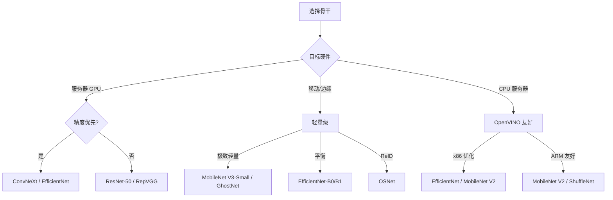
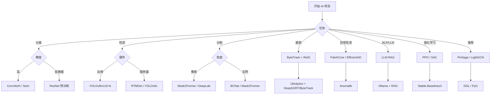

# 附录 A 经典模型选型速查表

> **附录目的**：将本教程涉及的所有主流模型进行横向对比，作为工程选型时的速查参考。
> 资料来源：综合 ML-DL 素材中的 `Resnet50 MobielNetV2 Inception-ResNet-V2 对比.md`、`yolov8.md`、`garbage collector.md`、`openvino全cpu使用问题.md`、`ufldl.md` 等根目录文件，以及各章节汇总数据。

---

## A.1 分类骨干网络对比

### A.1.1 ImageNet 性能总览

| 骨干网络 | 论文年份 | Top-1 | Top-5 | FLOPs | 参数量 | 推荐用途 |
|---------|---------|-------|-------|-------|--------|----------|
| **VGG-16** | 2014 | 71.3% | 90.1% | 15.4G | 138M | 教学、结构简单 |
| **Inception V3** | 2015 | 77.3% | 93.4% | 11.5G | 24M | 经典、多尺度 |
| **ResNet-50** | 2015 | 76.0% | 93.0% | 4.1G | 25M | 工业标准 |
| **ResNet-101** | 2015 | 77.4% | 93.6% | 7.8G | 44M | 高精度 |
| **ResNet-152** | 2015 | 78.6% | 94.1% | 11.6G | 60M | 极致精度 |
| **DenseNet-121** | 2017 | 75.0% | 92.3% | 2.8G | 8M | 参数效率高 |
| **ResNeXt-50** | 2017 | 77.4% | - | 4.2G | 25M | 基数维度 |
| **SENet-50** | 2017 | 78.4% | 94.2% | 4.1G | 28M | 通道注意力 |
| **MobileNet V1** | 2017 | 70.6% | 89.5% | 569M | 4.2M | 极致轻量 |
| **MobileNet V2** | 2018 | 72.0% | 91.0% | 300M | 3.4M | 移动端 |
| **MobileNet V3-L** | 2019 | 75.2% | 92.6% | 219M | 5.4M | 移动端首选 |
| **ShuffleNet V2** | 2018 | 69.4% | - | 146M | 2.3M | 极轻量 |
| **EfficientNet-B0** | 2019 | 77.3% | 93.5% | 390M | 5.3M | 平衡 |
| **EfficientNet-B3** | 2019 | 81.7% | 95.6% | 1.8G | 12M | 高精度 |
| **EfficientNet-B7** | 2019 | 84.3% | 96.9% | 37G | 66M | 极致精度 |
| **RegNetX-3.2GF** | 2020 | 78.5% | - | 3.2G | 15M | 设计空间 |
| **RegNetY-32GF** | 2020 | 82.6% | - | 32G | 145M | 工业 SOTA |
| **RepVGG-A0** | 2021 | 72.4% | - | 1.4G | 8.3M | GPU 实时 |
| **RepVGG-B3** | 2021 | 80.6% | 95.5% | 11.8G | 110M | GPU 高精度 |
| **Swin-T** | 2021 | 81.3% | - | 4.5G | 29M | Transformer |
| **ConvNeXt-T** | 2022 | 82.1% | 95.6% | 4.5G | 29M | CNN SOTA |
| **ConvNeXt-B** | 2022 | 83.8% | 96.6% | 15.4G | 89M | 高精度 |
| **EfficientFormerV2** | 2022 | 83.3% | - | - | 13M | 轻量 Transformer |
| **ConvNeXt V2-T** | 2023 | 83.9% | 96.7% | 4.5G | 29M | 自监督增强 |
| **EfficientViT** | 2023 | 83.5% | - | 0.5G | 5.4M | 移动端 ViT |

### A.1.2 三大经典骨干详细对比（ResNet50 vs MobileNetV2 vs Inception-ResNet-V2）

参考 ML-DL `Resnet50 MobielNetV2 Inception-ResNet-V2 对比.md` 的内容。

| 维度 | ResNet-50 | MobileNet V2 | Inception-ResNet-V2 |
|------|-----------|--------------|---------------------|
| **论文** | He et al. CVPR 2016 | Sandler et al. CVPR 2018 | Szegedy et al. AAAI 2017 |
| **核心思想** | 残差连接 | 深度可分离卷积 + 倒置瓶颈 | Inception 多尺度 + 残差 |
| **参数量** | 25.6M | 3.4M | 55.8M |
| **FLOPs** | 4.1B | 0.3B | 13.2B |
| **Top-1 (ImageNet)** | 76.0% | 72.0% | 80.1% |
| **Top-5** | 93.0% | 91.0% | 95.1% |
| **推理速度 (CPU)** | 中 | **极快** | 慢 |
| **推理速度 (GPU)** | 中 | 快 | 慢 |
| **适用硬件** | 服务器、桌面 | 移动、嵌入式 | 服务器 |
| **可作为骨干** | 检测/分割通用 | 移动端检测 | 高精度检测 |
| **易部署** | ⭐⭐⭐⭐⭐ | ⭐⭐⭐⭐⭐ | ⭐⭐⭐ |

**选型建议**：
- **追求精度**：Inception-ResNet-V2（Top-1 高，但慢）
- **追求速度**：MobileNet V2（参数少，CPU 友好）
- **平衡选择**：ResNet-50（生态最好）
- **特殊场景**：
  - 移动端 → MobileNet V2/V3
  - 工业边缘 → ResNet-50 (TensorRT 优化成熟)
  - 学术研究 → ConvNeXt (CNN) 或 Swin (Transformer)

### A.1.3 骨干网络决策树

---

## A.2 检测模型对比

### A.2.1 YOLO 系列完整对比

| 模型 | 年份 | mAP@0.5 | mAP@0.5:0.95 | FPS (V100) | 推荐场景 |
|------|------|---------|---------------|-----------|----------|
| **YOLOv3** | 2018 | 55.3 | 31.0 | 78 | 经典 |
| **YOLOv4** | 2020 | 62.8 | 40.2 | 62 | tricks 集大成 |
| **YOLOv5s** | 2020 | 55.2 | 36.7 | 455 | 速度优先 |
| **YOLOv5m** | 2020 | 63.2 | 44.5 | 213 | 平衡 |
| **YOLOv5l** | 2020 | 66.9 | 48.2 | 122 | 高精度 |
| **YOLOv5x** | 2020 | 68.9 | 50.4 | 87 | 极致精度 |
| **PP-YOLOv2** | 2021 | 65.0 | 49.5 | 68 | 工业部署 |
| **YOLOX-S** | 2021 | 59.5 | 40.4 | 1020 | 极快 |
| **YOLOX-L** | 2021 | 68.6 | 50.1 | 286 | 高精度 |
| **YOLOv6-T** | 2022 | - | 43.1 | 779 | 移动端 |
| **YOLOv6-L** | 2022 | - | 52.0 | 175 | 平衡 |
| **YOLOv7-T** | 2022 | 64.5 | 44.8 | 532 | 极快 |
| **YOLOv7-E6E** | 2022 | 71.4 | 56.0 | 75 | 极致精度 |
| **YOLOv8n** | 2023 | 52.6 | 37.3 | 280 | 移动端 |
| **YOLOv8s** | 2023 | 61.8 | 44.9 | 220 | 平衡 |
| **YOLOv8m** | 2023 | 67.2 | 50.2 | 90 | 高精度 |
| **YOLOv8l** | 2023 | 69.7 | 52.9 | 60 | 精度+速度 |
| **YOLOv8x** | 2023 | 71.0 | 53.9 | 40 | 极致精度 |
| **YOLOv9-T** | 2024 | 64.2 | 48.0 | 250 | 平衡 |
| **YOLOv10-N** | 2024 | 51.2 | 38.5 | **650+** | 极致实时 |
| **YOLOv10-X** | 2024 | **73.0** | 55.5 | 160 | 端到端无 NMS |
| **YOLOv11m** | 2024 | 68.5 | 50.5 | 100 | 最新均衡 |
| **RTMDet-M** | 2023 | 65.7 | 50.4 | 200 | OpenMMLab 工业首选 |
| **RTMDet-L** | 2023 | 68.8 | 52.1 | 130 | 工业级 |

### A.2.2 两阶段 vs 单阶段 vs Anchor-Free

| 范式 | 代表 | 优势 | 劣势 |
|------|------|------|------|
| **两阶段** | Faster R-CNN | 精度高 | 速度慢 |
| **单阶段 Anchor-Based** | YOLOv5/v7 | 平衡 | 超参敏感 |
| **单阶段 Anchor-Free** | YOLOv8/v10, CenterNet, FCOS | 简洁、泛化 | 早期精度低 |
| **Transformer 端到端** | DETR, RT-DETR | 无 NMS | 训练慢 |

### A.2.3 检测选型速查

| 场景 | 推荐 |
|------|------|
| **移动端实时** | YOLOv8n / YOLOv10-N |
| **服务器高精度** | RTMDet-L / YOLOv8x |
| **端到端无 NMS** | YOLOv10 / RT-DETR |
| **遮挡密集** | BCNet 双图层 |
| **卫星/遥感** | YOLT |
| **工业标准** | RTMDet (mmdetection) |
| **最新 + 均衡** | YOLOv11m |

---

## A.3 分割模型对比

### A.3.1 语义分割

| 模型 | 年份 | mIoU (Cityscapes) | mIoU (ADE20K) | 特点 |
|------|------|-------------------|---------------|------|
| **FCN** | 2014 | 62.7 | - | 首个端到端分割 |
| **U-Net** | 2015 | - | - | 医学图像首选 |
| **SegNet** | 2017 | 57.0 | - | 内存高效 |
| **GCN** | 2017 | 76.9 | - | 大核感受野 |
| **DeepLab V3+** | 2018 | 78.5 | - | ASPP |
| **PSPNet** | 2017 | 78.4 | - | 金字塔池化 |
| **HRNet** | 2019 | 80.7 | - | 高分辨率保持 |
| **OCRNet** | 2020 | 81.0 | - | 物体上下文 |
| **Mask2Former** | 2022 | 84.3 | 57.7 | 统一 mask 分类 |
| **OneFormer** | 2023 | **85.3** | - | 单模型多任务 |
| **SegFormer** | 2021 | 81.3 | 51.8 | Transformer 轻量 |
| **Mask2Former (Swin-L)** | 2022 | **86.3** | - | SOTA 精度 |
| **SAM (Segment Anything)** | 2023 | - | - | 零样本分割 |

### A.3.2 实例分割

| 模型 | 年份 | Mask AP (COCO) | FPS | 特点 |
|------|------|----------------|-----|------|
| **Mask R-CNN** | 2017 | 37.5 | 11 | 检测+分割经典 |
| **YOLACT** | 2019 | 29.8 | 45 | 实时实例分割 |
| **BCNet** | 2021 | 39.8 | - | 遮挡双图层 |
| **Mask2Former** | 2022 | 50.1 | 6 | 统一 mask |
| **SOLO v2** | 2020 | 41.4 | - | 实例分割新视角 |
| **QueryInst** | 2021 | 40.6 | - | 端到端查询 |
| **OneFormer** | 2023 | 49.0 | - | 统一架构 |

### A.3.3 分割选型

| 任务 | 推荐 |
|------|------|
| **医学图像** | U-Net / nnU-Net |
| **自动驾驶** | SegFormer / DeepLab V3+ |
| **实时分割** | BiSeNet / STDC |
| **高精度实例分割** | Mask2Former / OneFormer |
| **密集遮挡** | BCNet |
| **零样本/开放** | SAM |

---

## A.4 跟踪与异常检测

### A.4.1 多目标跟踪（MOT）算法

| 算法 | 年份 | MOTA (MOT17) | IDF1 | FPS | 特点 |
|------|------|--------------|------|-----|------|
| **SORT** | 2016 | 59.8 | 53.8 | 143 | IoU + Kalman |
| **DeepSORT** | 2017 | 60.3 | 63.1 | 18 | + ReID 外观 |
| **Tracktor++** | 2019 | 67.6 | 68.5 | 4 | 用检测回归 |
| **CenterTrack** | 2020 | 67.8 | 64.7 | 22 | 中心点偏移 |
| **TransTrack** | 2021 | 75.2 | 63.5 | 5 | Transformer |
| **ByteTrack** | 2022 | **80.3** | 77.3 | 105 | 高低分两轮 |
| **OC-SORT** | 2023 | 80.4 | 77.5 | 35 | 观测中心化 |
| **BoT-SORT** | 2022 | 80.5 | 80.2 | 12 | Camera Motion |
| **Deep OC-SORT** | 2023 | 80.6 | 80.4 | 20 | OC-SORT + ReID |

### A.4.2 异常检测算法

| 方法 | 年份 | MVTec AD AUROC | FPS | 是否需训练 |
|------|------|----------------|-----|---------|
| **AE (L2)** | 2015 | 78.0 | 50 | 是 |
| **VAE** | 2017 | 85.0 | 45 | 是 |
| **AnoGAN** | 2017 | 80.0 | 10 | 是 |
| **PaDiM** | 2021 | 96.7 | 30 | 否 |
| **PatchCore** | 2022 | **99.6** | 50 | 否 |
| **DRAEM** | 2022 | 98.0 | 25 | 是 |
| **SimpleNet** | 2023 | 98.7 | 60 | 是 |
| **FastFlow** | 2022 | 96.8 | 80 | 是 |
| **EfficientAD** | 2024 | 99.0 | 100+ | 是 |
| **Dinomaly** | 2024 | 99.6 | 25 | 是 |

### A.4.3 选型速查

| 场景 | 推荐 |
|------|------|
| **实时 MOT** | ByteTrack |
| **遮挡 MOT** | OC-SORT / BoT-SORT |
| **跨摄像头 ReID** | DeepSORT + ReID |
| **工业异常 SOTA** | PatchCore |
| **工业实时异常** | EfficientAD / FastFlow |
| **零样本异常** | WinCLIP / DINOv2 + PatchCore |

---

## A.5 注意力模块对比

| 模块 | 年份 | 通道 | 空间 | 长距离 | 参数 | 增益 | 适用 |
|------|------|------|------|--------|------|------|------|
| **SE-Net** | 2018 | ✅ | ❌ | ❌ | 中 | +1.0% | 通用首选 |
| **CBAM** | 2018 | ✅ | ✅ | ❌ | 中 | +1.4% | 通用 |
| **ECA-Net** | 2020 | ✅ | ❌ | ❌ | 极低 | +0.9% | 极致轻量 |
| **CA (Coordinate)** | 2021 | ✅ | ✅ | ✅ | 低 | +1.2% | 移动端 |
| **SimAM** | 2021 | ✅ | ✅ | 部分 | **0** | +0.8% | 极轻量 |
| **SK-Net** | 2019 | ✅ | 部分 | ❌ | 中 | +0.8% | 多尺度 |
| **Non-Local** | 2018 | ✅ | ✅ | ✅ | 高 | +1.7% | 像素级 |

---

## A.6 归一化方法对比

| 方法 | 归一化维度 | 大 Batch | 小 Batch | Transformer | 检测/分割 |
|------|----------|---------|---------|-------------|----------|
| **BN** | 跨 batch | ⭐⭐⭐⭐⭐ | ⭐ | ❌ | 标准 |
| **LN** | 跨 C/H/W | ⭐⭐⭐⭐⭐ | ⭐⭐⭐⭐⭐ | ⭐⭐⭐⭐⭐ | 一般 |
| **IN** | 跨 H/W | ⭐⭐⭐ | ⭐⭐⭐ | ❌ | 风格迁移 |
| **GN** | 跨 group | ⭐⭐⭐⭐⭐ | ⭐⭐⭐⭐⭐ | ❌ | ⭐⭐⭐⭐⭐ |
| **SN** | 混合 | ⭐⭐⭐⭐ | ⭐⭐⭐⭐ | ❌ | 通用 |

---

## A.7 部署框架对比

### A.7.1 推理引擎性能对比（YOLOv8s, 640×640, batch=1）

| 框架 | 硬件 | 单图延迟 | 备注 |
|------|------|----------|------|
| PyTorch FP32 | RTX 3090 | 12.5 ms | 基线 |
| PyTorch FP16 | RTX 3090 | 7.2 ms | AMP |
| ONNX Runtime CUDA | RTX 3090 | 6.8 ms | 跨平台 |
| **TensorRT FP32** | RTX 3090 | 12 ms | 算子融合 |
| **TensorRT FP16** | RTX 3090 | **4.1 ms** | 极致 |
| **TensorRT INT8** | RTX 3090 | **2.6 ms** | 需校准 |
| OpenVINO | i7-12700 | 75 ms | Intel 优化 |
| OpenVINO | Xeon 8280 | 38 ms | 服务器 |
| ncnn | Snapdragon 888 | 95 ms | 移动 ARM |
| CoreML | Apple M1 | 22 ms | iOS/macOS |
| TFLite | Pixel 6 | 110 ms | Android |

### A.7.2 部署框架选型

| 目标平台 | 推荐 |
|---------|------|
| NVIDIA GPU 服务器 | **TensorRT** |
| Intel CPU 服务器 | **OpenVINO** |
| ARM 边缘 (Jetson) | **TensorRT** |
| 移动端 iOS | CoreML |
| 移动端 Android | TFLite / ncnn |
| 跨平台通用 | **ONNX Runtime** |
| 学术研究 | PyTorch 原生 |

---

## A.8 NVIDIA Jetson 算力对比

| 型号 | 算力 (INT8) | 内存 | 功耗 | 适用 |
|------|-------------|------|------|------|
| Jetson Nano | 0.5 TOPS | 4GB | 5-10W | 教学 |
| Jetson TX2 | 1.3 TOPS | 8GB | 7.5-15W | 工业 |
| Jetson Xavier NX | 21 TOPS | 8/16GB | 10-20W | 机器人 |
| Jetson AGX Xavier | 32 TOPS | 32GB | 10-30W | 自动驾驶 |
| Jetson Orin Nano | 40 TOPS | 4/8GB | 7-15W | 边缘 AI |
| **Jetson Orin NX** | 100 TOPS | 8/16GB | 10-25W | 高性能边缘 |
| Jetson AGX Orin | 275 TOPS | 32/64GB | 15-60W | 工业级 |

---

## A.9 大语言模型对比

### A.9.1 主流开源 LLM

| 模型 | 机构 | 参数量 | 上下文 | 强项 | 部署 |
|------|------|--------|--------|------|------|
| **Llama 3** | Meta | 8B / 70B | 8K | 通用对话 | Ollama |
| **Qwen 2.5** | 阿里 | 7B / 14B / 72B | 128K | 中文 | Ollama |
| **DeepSeek-V3** | DeepSeek | 67B MoE | 64K | 推理、代码 | API / 本地 |
| **ChatGLM-4** | 智谱 | 9B | 128K | 中文、工具 | Ollama |
| **Mistral** | Mistral AI | 7B | 32K | 英文 | Ollama |
| **Gemma 2** | Google | 9B / 27B | 8K | 轻量 | Ollama |
| **Phi-3** | Microsoft | 3.8B | 128K | 极致轻量 | Ollama |
| **Yi** | 01.AI | 6B / 34B | 200K | 中英双语 | Ollama |
| **Qwen-VL** | 阿里 | 7B | - | 多模态 | Ollama |
| **DeepSeek-Coder** | DeepSeek | 6.7B | 16K | 代码 | Ollama |

### A.9.2 选型建议

| 场景 | 推荐 |
|------|------|
| **中文通用** | Qwen 2.5 / DeepSeek-V3 |
| **英文通用** | Llama 3 / Mistral |
| **极致轻量** | Phi-3 / Gemma 2 9B |
| **代码生成** | DeepSeek-Coder / CodeLlama |
| **多模态** | Qwen-VL / LLaVA |
| **长文本** | Yi 200K / Qwen 128K |

---

## A.10 框架与工具速查

### A.10.1 训练框架

| 框架 | 优势 | 适合 |
|------|------|------|
| **PyTorch** | 主流、灵活 | 学术 + 工业 |
| **TensorFlow** | 部署成熟 | 工业生产 |
| **JAX** | 高性能 | 研究 |
| **PaddlePaddle** | 中文文档 | 国产化 |
| **MindSpore** | 华为生态 | 国产化 |

### A.10.2 视觉算法库

| 库 | 任务 | 优势 |
|------|------|------|
| **MMDetection** | 检测 / 实例分割 | 算法覆盖广 |
| **MMSegmentation** | 语义分割 | 训练 Pipeline 完善 |
| **MMClassification** | 图像分类 | 100+ 骨干 |
| **MMTracking** | 多目标跟踪 | MOT + SOT + VID |
| **MMOCR** | OCR | 检测 + 识别 |
| **MMPose** | 姿态估计 | 多种 backbone |
| **MMagic** | 生成 / 超分 | Diffusion 支持 |
| **Ultralytics** | YOLO 系列 | 简单易用 |
| **Detectron2** | 检测 / 分割 | Meta 出品 |
| **Anomalib** | 异常检测 | Intel 出品 |

### A.10.3 部署框架

| 框架 | 任务 | 优势 |
|------|------|------|
| **ONNX Runtime** | 跨平台推理 | OpenAI 兼容 |
| **TensorRT** | NVIDIA 优化 | 极致性能 |
| **OpenVINO** | Intel 优化 | CPU 友好 |
| **ncnn** | 移动端 | ARM 友好 |
| **TFLite** | 移动端 | Google 生态 |
| **CoreML** | Apple 平台 | iOS/macOS |
| **MMDeploy** | 统一部署 | OpenMMLab 配套 |

### A.10.4 实验管理

| 工具 | 特点 |
|------|------|
| **W&B** | 行业标准 |
| **MLflow** | 开源 |
| **TensorBoard** | 学术友好 |
| **DVC** | 数据版本 |
| **ClearML** | 完整 MLOps |
| **Neptune** | 团队协作 |

### A.10.5 知识图谱与图学习

| 库 | 任务 |
|------|------|
| **DGL** | 图神经网络 |
| **PyG** | 图深度学习 |
| **PyKEEN** | KG 嵌入 |
| **RDFLib** | SPARQL 查询 |
| **NetworkX** | 图分析 |
| **Faiss** | 向量检索 |
| **ChromaDB** | 轻量级向量库 |
| **Milvus** | 分布式向量库 |

---

## A.11 工程选型决策树（综合）

---

## A.12 综合建议：按场景的最优选型

| 场景 | 模型组合 |
|------|----------|
| **移动端图像分类** | MobileNetV3 + ImageNet 预训练 |
| **移动端目标检测** | YOLOv8n + TFLite/CoreML |
| **服务器目标检测** | RTMDet-L + TensorRT FP16 |
| **服务器异常检测** | PatchCore + 正常样本训练 |
| **服务器分割** | Mask2Former + Swin-L |
| **服务器 OCR** | PaddleOCR + TensorRT |
| **服务器 LLM 应用** | Qwen2.5 72B + vLLM + RAG |
| **边缘 LLM** | Qwen2.5 7B + Ollama + TensorRT-LLM |
| **工业质检** | RTMDet + PatchCore + Jetson |
| **视频分析** | YOLOv8 + ByteTrack + ReID |
| **自动驾驶感知** | BEVFormer + TensorRT INT8 |

---

## A.13 快速对照表（一张表记住）

| 任务 | 快速选型 | 备选 |
|------|----------|------|
| **小数据集分类** | ResNet-50 ImageNet 预训练 + 微调 | ConvNeXt-T |
| **大模型预训练** | ConvNeXt-V2 + FCMAE | Swin-L |
| **移动端** | MobileNetV3-Small | ShuffleNetV2 |
| **服务器高精度** | ConvNeXt-B/L | EfficientNet-B7 |
| **目标检测首选** | YOLOv8 / RTMDet | Faster R-CNN |
| **分割首选** | DeepLabV3+ | Mask2Former |
| **多目标跟踪** | ByteTrack | OC-SORT |
| **异常检测** | PatchCore | EfficientAD |
| **本地 LLM** | Ollama + Qwen2.5 | LM Studio + Llama3 |
| **LLM 应用** | Qwen2.5 + RAG | Llama 3 + LangChain |
| **Jetson 部署** | TensorRT FP16 | ONNX Runtime |
| **移动端部署** | TFLite / ncnn | CoreML (iOS) |

---

## 本附录小结

1. **分类骨干**：从 VGG → ResNet → EfficientNet → ConvNeXt 持续演进
2. **检测**：YOLOv8/v10/v11 是当前工业首选，RTMDet 是 OpenMMLab 标杆
3. **分割**：Mask2Former / OneFormer 是 SOTA，U-Net 仍是医学首选
4. **跟踪**：ByteTrack 简单高效，OC-SORT/BoT-SORT 处理遮挡
5. **异常检测**：PatchCore 是当前 SOTA
6. **注意力**：SE/ECA/SimAM 是轻量首选，CA 处理长距离
7. **部署**：TensorRT 是 NVIDIA 平台极致选择，OpenVINO 是 Intel 首选
8. **LLM**：Qwen2.5 / Llama3 是开源首选，Ollama 让本地部署极简
9. **实战选型**：先 baseline，再迭代；根据硬件选模型，根据业务选指标

---

## 参考资料

1. ML-DL 参考：Resnet50 MobielNetV2 Inception-ResNet-V2 对比.md
2. ML-DL 参考：yolov8.md
3. ML-DL 参考：openvino全cpu使用问题.md
4. ML-DL 参考：garbage collector.md
5. ML-DL 参考：ufldl.md
6. Papers with Code：https://paperswithcode.com
7. timm (PyTorch Image Models)：https://github.com/huggingface/pymodels
8. Ultralytics Docs：https://docs.ultralytics.com
9. MMDetection 文档：https://mmdetection.readthedocs.io
10. Anomalib：https://github.com/openvinotoolkit/anomalib
11. OpenMMLab 全套：https://openmmlab.com
12. Ollama 模型库：https://ollama.com/library
